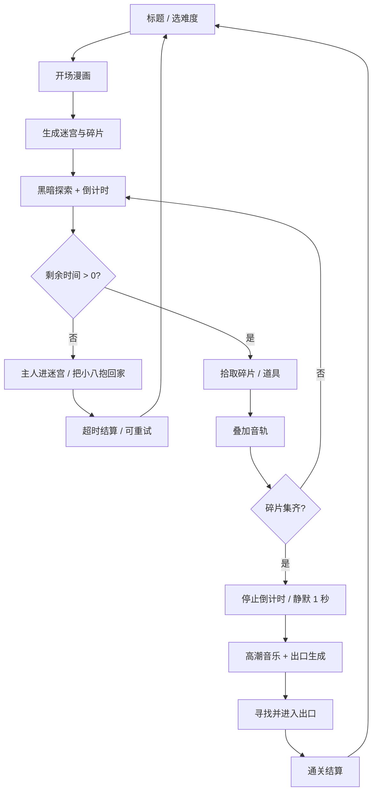
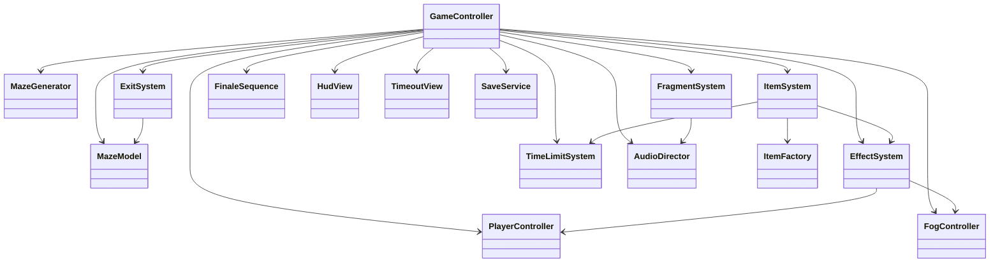

# 《喵音回廊》开发文档

> **Meowlo Corridor** · 2D 音乐探索解谜  
> 引擎：Cocos Creator 3.8.8 + TypeScript　|　平台：HarmonyOS NEXT（比赛指定手机）  
> 文档版本：v1.2　|　日期：2026-10-18　|　状态：M0.5 可玩骨架已实现（校内比赛开发基线）  
> 项目性质：单机、离线、校内比赛 Demo；不公开发行、不商业化、不联网。

**v1.2 实施进度摘要：**

- 已完成 M0/M0.5 可玩骨架，并提交 Git：`d692f9f 喵音回廊V1.0`。
- 2 格视野已从格子遮罩升级为 **Shader 柔边遮罩**，含加载失败回退。
- 新增屏幕方向键、暂停按钮、鼠标拖动；键鼠/滑动/方向键均可操作。
- `DemoGame.ts` 已拆分为 `MazeRenderer / PlayerController / HudView / ItemSystem / UiKit / DemoTypes`。
- 详细实现状态、代码映射、验证结果与偏差见 **§11 实施进度与代码映射**。

**v1.1 调整摘要：**

- 鸿蒙构建后置：按“迷宫整体 → 2D 资源 → 音乐 → 鸿蒙构建”排期。
- 新增每关倒计时：超时后主人进入迷宫，把小八抱回家，本关强制结束。
- 扩展道具：小鱼干（+20s）、毛线球（路径记忆）、蝙蝠黑羽（-10s 陷阱）。
- 新增设计模式、Cocos Creator 编程规范、资源/构建规范与代码评审清单。
- 移除商业化/上架相关内容，改为校内比赛交付（HAP + 源码 + 文档 + 视频 + PPT）。

---

## 0. 文档说明

### 0.1 目的与读者

本文档是《喵音回廊》从立项到**校内比赛提交**的唯一设计基线，覆盖玩法、叙事、系统、数值、技术架构、美术音频规范、开发计划、测试与参赛交付。读者包括策划、客户端、美术、音频、QA、答辩与项目管理。

**阅读路线：**

| 角色 | 优先章节 | 关注点 |
|---|---|---|
| 策划 / 制作 | §1–§5、§9–§11 | 核心循环、数值、节奏、范围、风险与实施进度 |
| 客户端 | §3–§7、附录 B/C | 遮罩、迷宫、音频分层、鸿蒙构建、代码规范 |
| 美术 | §2、§4.9、§8 | 风格、色板、资产规格、UI |
| 音频 | §3.5、§4.8、§8.5 | 分层结构、同步、1 秒静默、混音 |
| QA / 答辩 | §7、§10 | 真机矩阵、现场演示、验收与交付 |

需求优先级：

| 优先级 | 含义 | 处理原则 |
|---|---|---|
| P0 | 缺失则核心体验不成立 | MVP 必须完成，不可砍 |
| P1 | 显著提升完成度 | 时间允许必做，可延后一个版本 |
| P2 | 锦上添花 / 长线内容 | 不进入比赛范围 |

### 0.2 命名约定

- 主角正式名：**老八**；主人和玩家口中的昵称：**小八**。文档与代码统一使用“老八”（`LaoBa`），UI 文案可随语境切换。
- 蝙蝠反派：**阿蝠**。表面是“偷 CD 的坏家伙”，本质是嫌音乐吵、又嘴硬的喜剧角色，不设计血腥或恐怖表现。
- CD 碎片：**碎片**；每块碎片承载歌曲的一条**音轨**。文中“碎片数”与“音轨数”同义。
- 一格 = 迷宫的一个可行走单元；视野半径 2 格 = 以老八所在格为中心、半径 2 格（直径约 5 格）的圆形可见区域。
- 一局 = 从进入迷宫到走出出口，或被主人抱走的完整流程。

### 0.3 设计基线速览

| 项目 | 基线 |
|---|---|
| 核心一句话 | 一只只能看见两格的猫，在会发声的迷宫里找回主人被蝙蝠打碎的 CD。 |
| 单局时长 | 轻松 2–3 分钟；标准 3–5 分钟；困难 5–7 分钟 |
| 迷宫 | 随机生成、全连通、必有可达出口；单屏不滚动 |
| 视野 | 半径 2 格，边缘柔化，其余全黑 |
| 碎片 | 轻松 3 / 标准 4 / 困难 5 块，藏在死路与角落 |
| 音乐 | 默认轻音乐；每拾取一块叠加一条音轨；集齐后静默 1 秒，从高潮段落大声播放 |
| 出口 | 集齐后生成在老八周边 3–5 步内，带光柱指引 |
| 道具 | 核心 5 种：蝴蝶、萤火虫、鲜花酒、猫条、下水道；扩展：小鱼干、毛线球、蝙蝠黑羽 |
| 时间限制 | 每关独立倒计时；超时后主人进入迷宫，把小八抱出，强制结束本关 |
| 失败条件 | 无死亡、无战斗失败；**超时 = 被主人抱回家**，本关结束，可立即重试 |
| 当前进度 | M0/M0.5 可玩骨架已完成（commit `d692f9f`）；下一步 M1 美术接入 |
| 项目性质 | 校内比赛单机 Demo；不公开发行、不商业化、不联网 |

### 0.4 需求追踪矩阵

| # | 原始需求 | 设计落点 | 验收方式 |
|---|---|---|---|
| 1 | 使用 Cocos 3.8 开发鸿蒙 2D 游戏 | 锁定 Cocos Creator 3.8.8；鸿蒙构建放在开发最后阶段，见 §7、§9 | 真机安装 HAP |
| 2 | 蝙蝠偷走主人的 CD，掉进迷宫碎成几块 | 三幕叙事，阿蝠 + 回廊 + 碎片，见 §2 | 开场/结局可完整播放 |
| 3 | 勇敢的老八进入迷宫找回碎片 | 主角老八，网格探索，见 §3 | 可完成一局 |
| 4 | 随机迷宫且必须有出路 | 细胞迷宫 + DFS + BFS 连通性校验，见 §4.1 | 1000 个种子全部连通 |
| 5 | 只能看见半径 2 格，其余黑暗 | 全屏遮罩 Shader，半径 2 格，见 §4.2 | 不同分辨率下半径正确 |
| 6 | 碎片分散在迷宫角落 | 优先死路、远端、彼此间隔，见 §4.4 | 每局碎片均在死路/角落 |
| 7 | 找齐全部碎片才出现出口 | 全收集事件后生成出口，见 §4.7 | 未集齐时出口不存在 |
| 8 | 每块碎片是一条音轨，默认轻音乐，逐条叠加 | 1 条底轨 + 最多 5 条碎片音轨，同 BPM/调性，见 §4.8 | 每次拾取听感增加一层 |
| 9 | 集齐后暂停 1 秒，从高潮大声播放 | 1.0 秒静默 + 高潮轨 + 演出，见 §4.8.4 | 时间轴误差 < 50ms |
| 10 | 出口生成在周边，走出即结束 | 周边 3–5 步生成音律门，见 §4.7 | 走入出口进入结算 |
| 11 | 五种道具：蝴蝶/萤火虫/鲜花酒/猫条/下水道 | 完整数值与交互；扩展小鱼干/毛线球/黑羽，见 §4.5 | 每种道具可复现 |
| 12 | 2D 游戏 | 固定俯视单屏、2D 精灵与 Shader，见 §8 | 60fps 真机运行 |
| 13 | 超时后主人把小八抱出、强制结束 | 每关倒计时 + 超时演出 + 失败结算，见 §4.11 | 时间归零后必定结束本关 |
| 14 | 校内比赛、非商业发行 | 范围/指标/交付按比赛 Demo 设计，见 §1.5、§7.4 | HAP + 源码 + 文档 + 视频可提交 |
| 15 | 开发节奏：迷宫 → 2D 资源 → 音乐 → 鸿蒙 | 里程碑严格按此顺序，见 §9.2 | 每个阶段有可运行版本 |
| 16 | 注意设计模式与 Cocos 编程规范 | 专项规范与评审清单，见 §6.14–§6.17 | 代码评审通过 |

---

## 1. 产品概述

### 1.1 一句话描述

> 主人的 CD 被阿蝠撞碎在黑暗回廊里。老八只能看见身边两格，却要凭着逐渐完整的音乐，找回每一块碎片，带主人走出迷宫。

### 1.2 核心体验

1. **听得见的进度**：每找到一块碎片，音乐就多一层。玩家不用看数字，也能“听出”自己离完整有多近。
2. **两格的勇气**：视野极小，未知很大。探索的紧张感来自“下一步会不会是死路”，而不是怪物或死亡。
3. **道具即规则**：蝴蝶改变方向感，萤火虫改变视野，鲜花酒颠倒操作，猫条改变移动节奏，下水道改变位置；小鱼干争取时间，毛线球记住来路，黑羽偷走时间。每件道具都是一次小型规则实验。
4. **温柔的结局**：通关是把音乐带回主人身边；超时是主人把你接回家。没有死亡画面，只有两种被音乐和主人接住的方式。

### 1.3 设计支柱

| 支柱 | 设计含义 | 可检验的问题 |
|---|---|---|
| 音乐是地图 | 音轨数量 = 收集进度 = 玩家情绪曲线 | 静音玩是否明显变难？是，则音乐承担了引导 |
| 黑暗是舞台 | 遮罩不是滤镜，是核心玩法 | 去掉遮罩后游戏是否变得平庸？是，则成立 |
| 道具是标点 | 道具打断节奏、制造记忆点，不堆砌 | 每个道具能否用一个动作说清楚？ |
| 温柔但不无聊 | 无死亡，但有方向迷失、资源风险与倒计时 | 玩家会为时间紧张，但不会觉得被恶意惩罚？ |

### 1.4 目标用户与场景

- **首要用户：校内比赛评委与试玩同学**。他们通常只给 3–8 分钟，需要快速看懂“两格视野 + 音乐拼图 + 限时回家”的卖点。
- 次要用户：喜欢猫咪/音乐/轻解谜的玩家；可用于赛后继续打磨，但不以公开发行为目标。
- 使用场景：比赛展台/答辩现场，一台 HarmonyOS 手机离线运行；开发期在 Cocos 编辑器与浏览器预览中完成。
- 平台：**HarmonyOS NEXT 手机**为唯一交付平台；不做 Android/iOS 适配。平板仅作可选展示，不列入必测范围。
- 演示原则：评委不需要教学文档，3 分钟内能完成“移动 → 拾取 → 听到音乐变厚 → 超时/通关”的任一闭环。

### 1.5 项目性质与范围

- **项目性质**：校内比赛单机 Demo，**不公开发行、不商业化、不联网、不做账号体系**；不涉及广告、内购、付费、排行榜、云存档。
- MVP 范围：1 个章节、3 个难度、5 种核心道具 + 2 种扩展道具 + 1 种陷阱、3–5 块碎片、每关倒计时、完整开场 + 通关/超时两套结局、设置与本地最佳记录、可安装 HAP。
- 参赛交付：HAP、完整 Cocos 源码、开发文档、README/构建说明、3 分钟演示视频、答辩 PPT、关键截图。
- 非目标：联机、排行榜、云存档、关卡编辑器、战斗、3D、多语言、商业化、公开发行、额外章节。
- P1 演示模式：固定种子 + 缩短流程（3 块碎片、5 分钟上限），用于答辩现场稳定复现“音乐高潮 → 出口”段落。

### 1.6 比赛导向的成功标准

| 维度 | 目标 | 说明 |
|---|---|---|
| 创意识别 | 3 分钟内理解核心 | 评委能说出“2 格视野 + 每块碎片加一层音乐 + 限时被主人抱走” |
| 完整闭环 | 3–6 分钟完成一局 | 开场 → 探索 → 集齐 → 高潮 → 出口/超时 → 结算 |
| 现场稳定 | 真机连续演示 10 次不崩溃 | 离线、固定设备、无外部依赖 |
| 帧率 | 60fps | 比赛指定中端 HarmonyOS 手机 |
| 超时反馈 | 玩家能理解“为什么结束” | 倒计时 + 主人抱走演出 + 结算文案 |
| 技术呈现 | 代码结构可讲清 | 状态机、事件、策略/工厂、对象池、Cocos 规范 |
| 演示保障 | 有视频与备用包 | 现场设备故障可立即切视频 |

---

## 2. 世界观与叙事

### 2.1 故事梗概

老宅深处有一条废弃的“喵音回廊”。主人珍藏着一张 CD——《回廊夜曲》，据说里面藏着一段只属于这个家的旋律。

某个黄昏，一只名叫阿蝠的蝙蝠溜进屋里，想找个安静的地方睡觉。主人的 CD 机一响，它被吵得炸毛，叼起 CD 就往外飞。慌乱中，CD 撞上回廊的梁柱，摔成几块，碎片散落在迷宫般的走廊深处。阿蝠嘴硬地说：“反正这么难听，拼不回来才好。”

老八从猫洞里钻了进来。他看不见整座迷宫，只能看清身边两格。但每找到一块碎片，音乐就会多一层；当所有音轨重新合在一起，回廊会打开一扇“音律门”。

最后，老八叼着完整的 CD 回到主人身边。CD 重新转动，阿蝠在窗边听着听着，睡着了。

如果老八在迷宫里耽搁太久，主人会循着猫叫找进来，把他从黑暗里抱回家。这一关就此结束，但老八下次还可以再试。

### 2.2 角色

| 角色 | 定位 | 外形 | 性格 | 叙事功能 |
|---|---|---|---|---|
| 老八（小八） | 主角 | 橘白猫，戴一枚 CD 形状的吊牌，尾巴有一撮白毛 | 好奇、嘴硬、怕黑但更怕主人失望 | 玩家化身；动作与表情承担主要情绪 |
| 主人 | 情感锚点 | 不出正脸，围裙、手、旧 CD 机；超时结局中会出现抱猫的手 | 温柔、耐心 | 开场、通关与超时结局的动机来源 |
| 阿蝠 | 喜剧反派 | 圆脸小蝙蝠，戴隔音耳罩，披风有点大 | 嘴硬、怕吵、其实不坏 | 制造冲突；结尾和解，避免“打死反派” |
| 引路蝶 | 道具角色 | 半透明蓝蝶，翅膀有音符纹 | 安静、灵动 | 蝴蝶道具的具象化 |
| 萤灯 | 道具角色 | 一小群萤火虫 | 活泼 | 萤火虫道具的具象化 |

### 2.3 三幕结构

| 幕 | 游戏段落 | 情绪 | 关键事件 |
|---|---|---|---|
| 第一幕：进入 | 标题 → 开场漫画 → 前 1–2 块碎片 | 好奇、微微紧张 | CD 碎裂；老八钻入回廊；学会移动与视野 |
| 第二幕：变奏 | 中段探索、道具、剩余碎片 | 专注、偶尔荒诞 | 音乐逐层变厚；鲜花酒/下水道制造意外 |
| 第三幕：高潮 | 最后一块碎片 → 1 秒静默 → 高潮 → 出口 | 释放、奔向出口 | 完整音轨、音律门、带回 CD |
| 尾声 | 结算 → 结局插画 | 温暖、满足 | 主人播放 CD；阿蝠睡着 |
| 超时结局 | 倒计时归零，任意探索阶段 | 紧张 → 被接住 | 主人循声进入回廊，把老八抱回家；本关强制结束 |

### 2.4 叙事呈现规范

- 开场 3 格漫画、通关 1 张 CG、超时 1 张暖色小插画；总量控制在 **600 字以内**，不打断操作。
- 游戏中只用一句话提示，例如：
  - 拾取第一块：“音轨 1/4。听到了吗？”
  - 拾取最后一块：“最后一段……回家了。”
  - 出口生成：“门开了。带它回家。”
  - 剩余 60 秒：“主人快找到你了。”
  - 超时：“回家吧，小八。”
- 超时不是恐怖惩罚：主人不打骂、不责怪，只是把猫抱走；画面暖色、音乐收束，给玩家“被接住”的安全感。
- 不写大段设定；世界观通过道具描述、环境细节和结尾补完。
- 阿蝠不出现血腥、伤害、死亡表现；它的“坏”是捣蛋和嘴硬。

---

## 3. 核心玩法

### 3.1 单局流程



### 3.2 规则总表

| 规则 | 定义 |
|---|---|
| 地图 | 单屏、固定俯视、不滚动；所有格子均可走，墙在格子之间 |
| 移动 | 四方向、逐格移动；不可斜走、不可穿墙 |
| 视野 | 以老八为中心、半径 2 格；边缘约 0.5 格柔化；其余接近全黑 |
| 碎片 | 每局 3–5 块，优先放在死路/角落；必须全部可达 |
| 出口 | **集齐全部碎片后**才生成；生成在老八周边 3–5 步内；进入即结束 |
| 音轨 | 初始只有轻音乐底轨；每块碎片叠加一条；集齐后进入高潮 |
| 道具 | 踩到即触发；增益/干扰/陷阱均有明确视听反馈 |
| 计时 | 每关独立**倒计时**；从获得操作权开始；暂停、演出、切后台时冻结 |
| 时间上限 | 轻松 5:00 / 标准 7:00 / 困难 9:00；集齐碎片后停止倒计时 |
| 步数 | 每移动一格计 1 步；用于结算与评价，不限制行动 |
| 失败 | 无死亡、无战斗失败；**倒计时归零 = 主人抱走小八，本关强制结束** |
| 超时处理 | 锁定输入 → 主人抱猫演出 → 超时结算；可立即重试或降低难度 |
| 暂停 | 暂停音乐、倒计时、道具计时、移动输入；恢复后继续 |

### 3.3 操作方案

**默认：滑动 + 可选方向键（同时支持）**

| 输入 | 行为 |
|---|---|
| 在屏幕任意非 UI 区域滑动 ≥ 24px | 取主轴方向移动 1 格 |
| 点按方向键 | 移动 1 格 |
| 长按方向键 | 0.25s 后每 0.22s 自动重复 |
| 键盘方向键 / WASD（编辑器与桌面） | 同等移动 |
| 双指/多点触控 | 只接受第一根手指，避免误触 |

- 滑动判定使用 `TOUCH_START → TOUCH_END` 的向量；小于阈值视为点按，不移动。
- 移动期间输入进入 1 格缓冲；连续滑动不会叠加成瞬移。
- 方向键默认放在右下角，支持“左手模式”镜像到左下角。
- 鲜花酒生效时，**所有方向输入映射取反**（上=下、左=右），UI 方向键图标不旋转，避免“二次反转”造成理解混乱。

### 3.4 视野与探索

- 基础可见半径 **2.0 格**；萤火虫期间 **4.0 格**。
- 可见区域内的地板、墙、碎片、道具、出口均正常显示；区域外由遮罩覆盖。
- 不做墙体遮挡（光线不因墙转弯），原因：半径已经很小，再叠加视线遮挡会让移动变成盲猜；用“猫的夜视”作为世界观解释。
- 例外：出口光柱、蝴蝶轨迹、HUD 指引**显示在遮罩之上**，保证终局可发现。
- 视野边缘加轻微呼吸/噪点，避免“纯黑圆圈”显得廉价；幅度必须低，不影响看清格子。

### 3.5 音乐推进

| 阶段 | 音乐内容 | 玩家感知 |
|---|---|---|
| 开局 | 只有轻音乐底轨（音乐盒 + 氛围垫） | 安静、空旷、有点孤单 |
| 拾取 1 | 加入贝斯 | 世界开始“有底” |
| 拾取 2 | 加入节奏 | 脚步不自觉跟着走 |
| 拾取 3 | 加入主旋律 | 歌曲轮廓出现 |
| 拾取 4 | 加入和声 | 情绪变得饱满 |
| 拾取 5（困难） | 加入对位旋律 | 完整编制 |
| 集齐 | 全部淡出 → **1.0 秒静默** → 高潮段大声进入 | 释放、起鸡皮疙瘩 |
| 逃离 | 高潮循环 + 出口音效 | 兴奋、想跑 |
| 结算 | 钢琴尾声 | 温柔收束 |

### 3.6 出口规则

- 集齐前：地图上**不存在**出口实体，也不显示出口 UI。
- 集齐后：在高潮进入时，于老八当前格 3–5 步（BFS 距离）内生成“音律门”。
- 出口必须满足：可走、可达、不是老八当前格、不与碎片/道具重叠、优先走廊或小空地。
- 出口带一道**穿透遮罩的光柱**，并在 HUD 显示方向箭头；确保玩家不会在最后阶段迷路。
- 老八走入出口格 → 输入锁定 → 出门演出 → 结算。出口不是入口，不要求原路返回。

### 3.7 难度设计

| 难度 | 迷宫 | 碎片 | 道具总数 | 下水道 | 环路 | 目标时长 | 时间上限 | 目标人群 |
|---|---|---:|---:|---:|---:|---|---:|---|
| 轻松 | 11×15（165 格） | 3 | 6 | 1 | 0% | 2–3 min | **5:00** | 首次接触、评委试玩 |
| 标准 | 13×17（221 格） | 4 | 8 | 2 | 5% | 3–5 min | **7:00** | 默认体验 |
| 困难 | 15×19（285 格） | 5 | 11 | 2 | 8% | 5–7 min | **9:00** | 熟悉规则、追求三星 |
| 每日 | 13×17 | 4 | 8 | 2 | 5% | 3–5 min | **7:00** | 日期种子、重复挑战（P1） |

- 难度不改变视野半径，保证核心规则一致；改变的是迷宫规模、碎片数、干扰密度、环路比例与时间上限。
- 时间上限设计成**安全网**而不是主要难度：正常通关用时约为上限的 50%–65%，只有迷路、反复试错或挂机才会超时。
- 无死亡、无战斗失败；走错、传送、方向颠倒只是“多走几步”，不会丢失已收集的音轨。唯一的失败是倒计时归零。
- 超时表现必须温和：主人来接，而不是惩罚；结算文案避免“失败”大字，使用“被抱回家”。

### 3.8 单局节奏

| 局内时间 | 体验目标 | 设计手段 |
|---|---|---|
| 0–20s | 学会移动、感受黑暗 | 出生点附近放一条短死路与第一个道具提示 |
| 20–90s | 找到第一块碎片 | 第一块碎片 BFS 距离约为全图 35%–45%，不放在最远 |
| 1–3min | 音乐变厚、开始使用道具 | 中段道具密度最高；蝴蝶/萤火虫保证出现 |
| 3–5min | 收集最后一块、情绪抬升 | 最后一块放在远端死路；音轨接近完整 |
| 剩余 60s | 时间压力出现 | HUD 变琥珀色、主人轻唤一次、音乐轻微抽离 |
| 剩余 30s | 明确“该回家了” | HUD 变玫瑰色、心跳声、提示“主人快找到你了” |
| 高潮 15s | 释放与奔跑 | 1 秒静默、全屏脉冲、出口近在咫尺；倒计时已停止 |
| 结算 10s | 满足与重玩 | 三星、最佳记录、同种子再来一次 |

### 3.9 时间限制规则摘要

| 项目 | 规则 |
|---|---|
| 计时起点 | 开场漫画结束、玩家获得操作权的第一帧 |
| 计时终点 | 走出出口；集齐碎片时提前停止倒计时；归零时进入超时 |
| 暂停/切后台 | 冻结；恢复后从剩余时间继续 |
| 终局演出 | 1 秒静默 + 高潮 + 出口生成期间冻结，不扣时间 |
| 超时触发 | 归零当帧锁定输入；若同一帧拾取最后一块碎片，**拾取优先**，进入终局 |
| 超时表现 | 主人从画面边缘进入 → 抱起老八 → 暖色淡出 → 超时结算 |
| 超时结果 | 本关强制结束；不记录三星；已拾取音轨不继承；可立即重试或降难度 |
| 时间道具 | 小鱼干 +20s；蝙蝠黑羽 -10s；都有上限与提示 |
| 公平性 | 出口 3–5 步、光柱可见；超时只作为迷路/挂机安全网 |

---

## 4. 系统详细设计

### 4.1 迷宫生成

#### 4.1.1 表示方式

采用**细胞迷宫（cell-based maze）**：每个格子都是可行走单元，墙存在于相邻格之间。

```ts
// 墙的顺序：北、东、南、西
interface MazeCell {
  x: number;
  y: number;
  walls: [boolean, boolean, boolean, boolean];
  visited: boolean;
}

interface MazeData {
  cols: number;
  rows: number;
  cells: MazeCell[];      // 索引 = y * cols + x
  start: GridPos;
  seed: number;
}
```

优点：

- 221 个格子都是可走的，探索密度高；不需要“墙格/地板格”两套坐标。
- 墙是边，渲染时可用一个 `Graphics` 批量绘制，draw call 低。
- 视野半径 2 格、BFS 距离、死路判定都直接基于格子，逻辑简单。
- 单屏固定镜头，不需要滚动与分块加载。

#### 4.1.2 生成算法

1. 初始化 `cols × rows` 个格子，四边都有墙。
2. 以 `start = (0, 0)` 为起点，使用**迭代式随机深度优先搜索（递归回溯）**打通墙壁。
3. DFS 保证：所有格子连通、无环、路径唯一——即“完美迷宫”。
4. 按难度进行**编织（braiding）**：随机拆除少量内部墙，制造环路，降低死路比例；不拆与碎片/出生点相邻的墙，保留“角落感”。
5. 用 BFS 从起点计算全图距离，验证所有格子可达。
6. 放置碎片与道具（见 §4.4、§4.5）。
7. 若任一步校验失败，换种子重试；最多 10 次，仍失败则回退到纯 DFS 迷宫。

```text
generate(cols, rows, seed, braid):
  cells = initAllWalls(cols, rows)
  stack = [start]; visited[start] = true
  while stack not empty:
    cur = stack.top()
    next = randomUnvisitedNeighbor(cur, rng)
    if next == null: stack.pop(); continue
    removeWall(cur, next)
    visited[next] = true
    stack.push(next)
  braidWalls(cells, braid, protectedCells)
  assert bfs(start).size == cols * rows
  return cells
```

#### 4.1.3 随机与种子

- 使用 `mulberry32` 或 `xorshift32`，禁止 `Math.random()` 直接参与关卡生成。
- 普通局：`seed = Date.now() & 0xffffffff`。
- 每日局：`seed = YYYYMMDD`。
- 暂停界面显示种子，便于复现 bug 与玩家分享。
- 结算可选“同种子再来一次”（P1），用于挑战同一迷宫。

#### 4.1.4 连通性与“必有出路”

- 完美迷宫天然连通；编织只拆墙、不封路，连通性不变。
- 所有碎片、道具、出口都必须通过 BFS 验证可达。
- 出口在终局动态生成，生成时再次用 BFS 从老八当前位置筛选 3–5 步候选格；因此“出口可达”是运行时保证，而不是概率保证。
- 出生点位于地图角落，视觉上保留“猫洞入口”；最终出口是魔法音律门，不要求回到入口。

#### 4.1.5 碎片与道具放置顺序

1. 生成并编织迷宫。
2. 计算 BFS 距离与死路列表（`walls` 中为 `true` 的数量 = 3）。
3. 选碎片：优先远端死路；彼此 BFS 距离 ≥ 4；不与出生点重叠；数量不足时放宽到“2 面墙的远端格”，仍保证间隔 ≥ 3。
4. 选道具：排除出生点、碎片格、碎片相邻格；优先走廊与岔路；下水道不放在死路末端（避免“刚拿到碎片就被传走”的挫败）。
5. 记录所有占用格，保证一格一物。
6. 终局生成出口时再排除所有占用格。

#### 4.1.6 渲染

- 地板：一张 128×128 无缝木地板贴图，`Sprite.Type.TILED` 铺满棋盘；贴图 Wrap Mode 设为 `REPEAT`，颜色偏暗，避免抢戏。
- 墙：单个 `Graphics` 在生成时绘制所有墙段；墙厚 10px，深色底 + 2px 暖色高光；不逐帧重绘。
- 墙段按格子边绘制，相邻格共享的墙只画一次。
- 棋盘整体缩放到可用区域，格子大小动态计算；不滚动镜头。
- 装饰（相框、CD、蛛网、猫爪印）只放在不可走区域或墙边，不阻挡阅读。

### 4.2 视野遮罩

#### 4.2.1 视觉规则

| 参数 | 值 | 说明 |
|---|---|---|
| 基础半径 | 2.0 格 | 核心规则，所有难度一致 |
| 萤火虫半径 | 4.0 格 | 持续 10s，平滑过渡 |
| 边缘柔化 | 0.55 格 | `smoothstep`，避免硬圆边 |
| 暗度 | 0.96–0.98 | 不是纯黑，保留极淡的环境纹理 |
| 呼吸幅度 | ±0.03 格 | 2–3 秒周期，增加生命感 |
| 可见内容 | 地板、墙、碎片、道具、出口 | 全部在遮罩下方正常渲染 |

#### 4.2.2 实现方案（首选：全屏 Shader）

在棋盘上方放一个与棋盘同尺寸的 `Sprite`（纯白 2×2 贴图 + 自定义材质），片元着色器根据像素到老八的距离输出黑色 alpha：

```glsl
float d = distance(pixelPos, playerPixelPos) / cellSize;
float alpha = smoothstep(radius, radius + softness, d);
return vec4(darkColor.rgb, darkColor.a * alpha);
```

- 遮罩节点放在 `WorldRoot` 之上、`GuideLayer` 与 `UIRoot` 之下。
- 移动补间期间每帧更新 `u_playerPos`，让光圈跟着猫平滑移动；静止时不提交。`u_radius` 只在萤火虫开始/结束或呼吸变化时更新，避免无意义提交。
- 使用设计分辨率坐标（与 `UITransform` 一致），不依赖物理像素，适配不同屏幕。
- 一个 draw call，无 RenderTexture，无额外相机。

**坐标换算：**

```ts
const ui = fogNode.getComponent(UITransform)!;
const local = ui.convertToNodeSpaceAR(playerWorldPos);
const px = new Vec2(local.x + ui.width * ui.anchorX,
                    local.y + ui.height * ui.anchorY);
material.setProperty('u_playerPos', px);
material.setProperty('u_size', new Vec2(ui.width, ui.height));
```

> **实现记录（M0.5）**：当前没有贴图资源，实际用 `Graphics` 白底矩形 + `resources/effects/fog.effect` 自定义材质，片元用预乘 Alpha；`u_player = vec4(localX, localY, cellSize, radius)` 打包，避免 UBO 隐式 padding。加载失败自动回退到格子遮罩。M1 有正式贴图后可替换为 Sprite 方案，接口不变。

#### 4.2.3 备用方案（Shader 异常时）

- 退化为**硬边视野**：用四块黑色矩形拼出方形可见区，或使用 `Mask` 的 `GRAPHICS_ELLIPSE + inverted` 挖一个椭圆洞。
- 半径通过缩放/移动遮罩节点实现；边缘为硬边，可接受但质感下降。
- 通过调试开关 `useMaskFallback` 切换；比赛构建前必须在真机验证 Shader 路径。降级方案只保证“可玩、能看清”，不追求柔边。

#### 4.2.4 特殊可见对象

| 对象 | 是否穿透遮罩 | 原因 |
|---|---|---|
| 出口光柱 | 是 | 终局必须可发现 |
| 蝴蝶与轨迹 | 是 | 引导道具的核心价值 |
| HUD 方向箭头 | 是（UI 层） | 防迷路 |
| 碎片微光 | 否 | 保持探索感；靠近 2 格内才可见 |
| 道具 | 否 | 同上 |
| 阿蝠（若出现） | 否 | 只作为开场/结尾叙事 |

#### 4.2.5 性能与适配

- Shader 只做一次距离计算与 `smoothstep`，中低端设备无压力。
- 遮罩尺寸跟随棋盘，不覆盖 HUD；HUD 在 Canvas 的更高层级。
- 切换分辨率/折叠屏展开时，重算棋盘缩放与 `u_size`，不要重建材质。
- 若设备不支持自定义材质，降级到硬边矩形/Mask 方案，并记录日志。

### 4.3 角色移动

#### 4.3.1 移动模型

- 老八始终位于格子中心；移动是格子到格子的补间，单格 **0.11–0.13s**。
- 移动开始前检查目标格是否有墙；有墙则播放“撞墙”反馈（轻微顿挫 + 音效），不进入目标格。
- 移动中锁定下一次移动；最多缓存 1 个方向输入，避免连点丢失手感。
- 进入格子的瞬间触发：碎片、道具、出口、脚步声、蝴蝶步数递减。
- 不采用物理引擎；纯网格逻辑 + Tween，确定性强、性能好。

#### 4.3.2 方向与动画

| 方向 | 动画 | 备注 |
|---|---|---|
| 上 / 下 / 左 / 右 | 四方向行走 6 帧 | 无斜向 |
| 待机 | 呼吸 + 尾巴摆动 | 4 方向各 1 套 |
| 撞墙 | 前倾 0.08s | 不位移 |
| 拾取 | 坐下/抬头 0.35s | 可被移动打断 |
| 进入出口 | 小跑 + 白光 | 终局专用 |

- 脚步音效每格一次，随地形轻微变化（木地板/地毯）。
- 移动时在脚下生成灰尘粒子；粒子池复用，避免 GC。

#### 4.3.3 猫条：移动格数增加

- 生效期间，**每次方向指令连续移动 2 格**；持续 10 秒。
- 连续移动的停止条件（任一满足）：
  1. 下一格是墙；
  2. 下一格有碎片/道具/出口；
  3. 已走满 2 格；
  4. 进入终局/暂停。
- 每个小格仍然检查碰撞与触发，不会“跳过”道具。
- 视觉：老八身后出现残影/猫爪拖尾；HUD 显示“×2”。
- 设计说明：将“移动格数增加”解释为“每次指令移动格数 1→2”，比“增加总步数资源”更符合即时手感，也不需要额外步数经济。若后续希望改成“+20 步”，只需调整 `EffectSystem` 与移动队列，不影响其他系统。

#### 4.3.4 鲜花酒：方向颠倒

- 生效期间，方向映射取反：上→下、下→上、左→右、右→左。
- 对滑动、方向键、键盘同时生效；对 UI 导航、暂停菜单不生效。
- 蝴蝶指引、HUD 箭头、出口方向不受影响（它们是“世界信息”，不是“操作输入”）。
- 视觉：玫瑰色边缘、轻微画面摇摆、方向键图标抖动但不旋转。
- 音效：每次反向移动伴随一声轻佻的“叮”，强化“喝晕了”的反馈。

#### 4.3.5 暂停与输入锁定

- 暂停时：停止移动 Tween、清空输入缓冲、冻结道具计时、暂停音乐。
- 终局 1 秒静默/高潮切换期间：输入锁定，避免玩家在演出中乱走。
- 出口进入、结算、开场漫画期间：输入锁定。
- 应用切后台：等同暂停；恢复时先恢复 UI，再恢复音频，避免“后台突然高潮”。

### 4.4 碎片与音轨

#### 4.4.1 碎片规则

| 项目 | 规则 |
|---|---|
| 数量 | 轻松 3 / 标准 4 / 困难 5 / 每日 4 |
| 位置 | 优先死路末端、地图角落、BFS 远端 |
| 间隔 | 彼此 BFS 距离 ≥ 4（轻松 ≥ 3） |
| 可见 | 仅在视野半径内可见；有轻微音乐符号粒子 |
| 拾取 | 走入格子即拾取；0.25s 轻顿帧 + 碎片飞向 HUD |
| 丢失 | 不存在丢失、偷取、失败掉落 |
| 顺序 | 无固定顺序；每块固定映射一条音轨 |

#### 4.4.2 音轨映射

| 碎片序号 | 音轨 | 音色 | 颜色 | HUD 缺口 |
|---|---|---|---|---|
| 1 | 贝斯 | 低音拨弦/合成贝斯 | 琥珀 | 左下 |
| 2 | 节奏 | 刷鼓、木鱼、轻打击 | 玫瑰 | 右下 |
| 3 | 主旋律 | 音乐盒/钢琴 | 青蓝 | 右上 |
| 4 | 和声 | 弦乐铺底 | 紫罗兰 | 左上 |
| 5 | 对位（困难） | 钟琴/口哨 | 薄荷 | 中心 |

- 初始只有“底轨”（音乐盒 + 氛围垫），不属于碎片。
- 每块碎片的音轨在**同一小节、同一调性**内，任意顺序叠加都和谐。
- HUD 的 CD 圆盘按缺口发光；集齐时圆盘闭合、旋转加速。

#### 4.4.3 拾取流程

1. 老八进入碎片格，移动立即停止。
2. 0.25s 轻顿帧：碎片放大、音乐短暂加亮。
3. 碎片飞向 HUD 的 CD 缺口（0.45s）。
4. 对应音轨音量从 0 渐入到目标值（0.8s）；其他音轨不重置。
5. Toast：“音轨 2/4 · 节奏”，伴随猫叫/纸张翻动声。
6. 恢复输入；若这是最后一块，进入终局序列。

### 4.5 道具系统

#### 4.5.1 总表

| 道具 | 类型 | 效果 | 持续 | 叠加规则 | 反制/风险 |
|---|---|---|---|---|---|
| 蝴蝶 | 增益 | 引导至最近未收集碎片，显示路径 | 10 个玩家步 | 刷新为 10 步 | 只指方向，不代走；玩家仍可能跟丢 |
| 萤火虫 | 增益 | 视野半径 2→4 格 | 10s | 剩余时间 +10s，上限 20s | 扩大视野但不显示全图 |
| 鲜花酒 | 干扰 | 上下左右输入颠倒 | 10s | 刷新为 10s，不叠加 | 方向感混乱；蝴蝶仍正确 |
| 猫条 | 增益 | 每次指令移动 2 格 | 10s | 刷新为 10s | 可能冲过头；遇物自动停 |
| 下水道 | 干扰/风险 | 随机传送到远处可行走格 | 瞬时 | 每个只能用一次 | 可能传送到陌生区域；终局禁用 |
| **小鱼干** | 增益 / 时间 | 剩余时间 +20s | 瞬时 | 每局最多 1 个；不超过初始上限 +20s | 不能替代探索；超时后无法挽回 |
| **毛线球** | 增益 / 路径 | 身后留下可见毛线路径，标记走过的路 | 15s | 刷新为 15s | 只记录已走路，不显示未探索区域 |
| **蝙蝠黑羽** | 陷阱 | 剩余时间 -10s，画面短暂变暗 | 瞬时 | 每个触发一次 | 藏在走廊；看见后可绕开 |

- 所有“10 秒 / 15 秒”均为**游戏内时间**：暂停、切后台、演出期间不流逝。
- 增益/干扰图标最多同时显示 3 个；更多时合并为“+N”。时间增减用 HUD 数字飘字 `+20s / -10s`。
- 鲜花酒与猫条可以同时存在：方向颠倒 + 每次 2 格，风险最高。
- 终局出口生成时，**清除所有临时效果**（含鲜花酒的颠倒与毛线球），避免胜利前被操作反转卡住；播放一次“音浪净化”特效。
- 小鱼干/黑羽直接修改 `TimeLimitSystem` 的剩余秒数，不属于 `EffectSystem` 的持续效果；超时判定统一由 `TimeLimitSystem` 负责。

#### 4.5.2 蝴蝶（引路蝶）

- 拾取后，蝴蝶从道具位置飞起，停在老八前方 1 格。
- 每走 1 步，重新计算“老八 → 最近未收集碎片”的 BFS 最短路径；蝴蝶沿路径向前飞 1 格。
- 在遮罩之上显示蝴蝶 + 未来 4 格的发光脚印/音符轨迹。
- 持续 10 个**玩家步**；猫条的 2 格移动算 2 步。
- 若目标碎片被拾取，自动切换到下一块最近的碎片；若全部收集且出口已生成，改为指向出口；若没有目标，蝴蝶飞走。
- 玩家偏离路径时，蝴蝶会重新计算并飞回正确方向，不惩罚。
- 与鲜花酒：蝴蝶方向不受颠倒影响，作为“可靠的世界信息”。

#### 4.5.3 萤火虫（萤灯）

- 拾取后，一圈萤火虫环绕老八，视野半径平滑扩到 4 格（0.6s）。
- 持续 10s；再次拾取时剩余时间 +10s，上限 20s。
- 结束前 2s，萤火虫开始稀疏闪烁；结束后 0.8s 内半径缩回 2 格。
- 与鲜花酒/猫条无冲突；与出口光柱叠加时，光柱仍可见。
- 视觉重点：让玩家“看到更多”的瞬间要有明显的“呼”一下的扩张感。

#### 4.5.4 鲜花酒

- 拾取后，画面边缘泛起玫瑰色，出现轻微桶形/摇摆效果；方向输入立即反转。
- 持续 10s；再次拾取刷新到 10s，不叠加。
- 不反转：暂停菜单、设置、HUD 按钮、蝴蝶指引、出口箭头。
- 结束前 2s，玫瑰色开始褪去，给玩家“快恢复了”的预期。
- 若在出口生成时仍生效，终局净化会清除；若在普通探索中结束，播放一声轻微的“嗝”。

#### 4.5.5 猫条

- 拾取后，老八获得 10s 的“猫条加速”：每次方向指令连续走 2 格。
- 连续走格时，每格仍触发拾取/道具/出口；遇到这些对象立即停在对象格。
- 撞墙时只走完能走的格数，剩余格数作废，不积累。
- 视觉：残影 + 爪印；音效：轻快的“哒哒”两声。
- 与鲜花酒同时生效时，先反转方向，再按 2 格移动。

#### 4.5.6 下水道

- 每个迷宫放置 1–3 个下水道格（按难度），外观为半开的铁栅栏，靠近时有水滴声。
- 老八踩上去 → 输入锁定 0.8s → 下坠演出 → 在随机远处格出现。
- 传送目标筛选：
  - 所有可行走格；
  - BFS 距离老八当前位置 ≥ 5（避免原地传送）；
  - 不是老八当前格、碎片格、道具格、出口格；
  - 尽量选择未探索区域（P1 体验优化）。
- 若没有满足条件的格子，逐步放宽距离到 ≥ 3；仍没有则取消传送并提示“堵住了”。
- 每个下水道**只能使用一次**，使用后栅栏闭合、变暗。
- 终局出口生成后，所有未使用的下水道关闭，避免胜利前被传走。
- 下水道是“风险/惊喜”道具，不是纯惩罚：它可能把玩家送到碎片附近，也可能送到更远处。

#### 4.5.7 生成规则

| 难度 | 蝴蝶 | 萤火虫 | 猫条 | 鲜花酒 | 下水道 | 小鱼干 | 毛线球 | 黑羽 | 合计 |
|---|---:|---:|---:|---:|---:|---:|---:|---:|---:|
| 轻松 | 1 | 1 | 1 | 1 | 1 | 1 | 0 | 0 | 6 |
| 标准 | 1 | 1 | 1 | 1 | 2 | 1 | 1 | 0 | 8 |
| 困难 | 2 | 1 | 2 | 1 | 2 | 1 | 1 | 1 | 11 |
| 每日 | 1 | 1 | 1 | 1 | 2 | 1 | 1 | 0 | 8 |

- 保证至少 1 个蝴蝶、1 个萤火虫、1 个小鱼干；标准及以上保证 1 个毛线球；黑羽只在困难出现。
- 轻松难度刻意不放毛线球/黑羽，先让评委和首次玩家掌握“视野 + 音轨 + 倒计时”三件事。
- 道具不放在出生点、碎片格、碎片相邻格；下水道与黑羽不放在死路末端。
- 同类道具尽量分散，避免连续两个鲜花酒把玩家逼疯。
- 首次遇到某道具时，用 1.5s 的非阻塞提示卡说明效果；之后不再重复。

> **实现记录（M0.5）**：当前只实现“标准”一行：1 蝴蝶、1 萤火虫、1 猫条、1 鲜花酒、2 下水道、1 小鱼干、1 毛线球，合计 8 个；黑羽已有代码路径但故意不放置。轻松/困难数量尚未数据化，留到 M1 配置表。

#### 4.5.8 交互矩阵

| 组合 | 结果 |
|---|---|
| 鲜花酒 + 蝴蝶 | 操作颠倒，但蝴蝶轨迹正确；玩家需要“反着按、跟着蝶” |
| 鲜花酒 + 猫条 | 反方向 + 2 格，高风险；遇到对象自动停 |
| 鲜花酒 + 萤火虫 | 看得更远，但方向仍反；建议先停下观察 |
| 猫条 + 蝴蝶 | 一次 2 格，蝴蝶计 2 步；引导消耗更快 |
| 萤火虫 + 出口 | 光柱与更大视野叠加，终局更清晰 |
| 下水道 + 蝴蝶 | 传送后蝴蝶重新计算路径 |
| 下水道 + 终局 | 下水道已关闭，不会触发 |
| 小鱼干 + 临近超时 | +20s 后继续倒计时；HUD 绿色飘字 |
| 黑羽 + 临近超时 | -10s 可能直接触发超时；需提前预警 |
| 毛线球 + 蝴蝶 | 毛线标记来路，蝴蝶指向去路；两者可同时存在 |
| 任意效果 + 暂停 | 计时冻结，恢复后继续 |
| 任意效果 + 切后台 | 等同暂停；恢复时先恢复画面再恢复音频 |

#### 4.5.9 小鱼干（时间增益）

- 外观：一小袋鱼干/沙丁鱼罐头，暖黄色微光。
- 拾取后立即 `remainingTime += 20`，HUD 显示绿色 `+20s` 飘字，播放轻快“叮”声。
- 单局最多 1 个；剩余时间不超过“初始时间上限 + 20s”，避免无限续命。
- 不暂停游戏，不打断移动；若在超时演出开始后拾取，不再生效（输入已锁定）。
- 集齐碎片后倒计时已停止，小鱼干失效（图标变灰，不显示 `+20s`），避免无意义的时间变化。
- 与时间上限的关系：初始 7:00，拾取后最多 7:20；HUD 仍显示倒计时，不显示“超出上限”。
- 设计目的：给迷路玩家一次“再试一下”的机会，同时不破坏倒计时的紧张感。

#### 4.5.10 毛线球（路径记忆）

- 外观：一团暖红色毛线，滚动时留下细线。
- 拾取后 15s 内，老八走过的格子留下低透明度毛线；毛线绘制在遮罩之上，因此能看见来路，但看不见未探索区域。
- 毛线只记录“已走过”的格子；不自动指路，不与蝴蝶叠加成完整地图。
- 最多记录 60 格；超过后最早的一段淡出，避免 Draw call/顶点无限增长。
- 视觉参数：线宽 3px、透明度 0.35、颜色 `#C96A7A`；每 2 格加一个小线结，方便数格。
- 与蝴蝶：蝴蝶指“去哪”，毛线记“从哪来”；同时存在时，画面信息量最大，但不至于全图透视。
- 与下水道：传送后毛线保留，玩家能看见传送前的来路（但通常已隔很远）。

#### 4.5.11 蝙蝠黑羽（陷阱）

- 外观：一根黑色羽毛，带一点紫色微光；只在困难难度出现。
- 老八踩上去 → 短促的蝙蝠翅声 + 画面暗一下 → `remainingTime -= 10` → HUD 红色 `-10s` 飘字。
- 黑羽不是拾取物，不进入 HUD 效果栏；触发一次后消失。
- 若扣减后时间 ≤ 0，立即进入超时演出；若同一帧拾取最后一块碎片，拾取优先。
- 集齐碎片后倒计时已停止，黑羽失效（只保留视觉，不再扣时间）。
- 可被看见并绕开；放在走廊而非死路末端，给玩家“看见了但来不及绕”的紧张感。
- 叙事：阿蝠在迷宫里掉的羽毛，碰到会想起“偷 CD 的坏家伙”，不是纯数值惩罚。

### 4.6 状态效果系统

```ts
type EffectType = 'butterfly' | 'firefly' | 'wine' | 'catStrip' | 'yarn';

interface ActiveEffect {
  type: EffectType;
  remain: number;      // 秒；蝴蝶用“步数”单独存
  duration: number;
  stacks: number;
}

interface EffectState {
  effects: Map<EffectType, ActiveEffect>;
  butterflySteps: number;
  visionRadius: number; // 当前平滑值
}
```

- 统一由 `EffectSystem.update(dt)` 驱动，仅在 `PLAYING/ESCAPE` 状态推进。
- 蝴蝶按步数扣减，不按秒；其他按秒。
- 小鱼干、蝙蝠黑羽是瞬时事件，直接调用 `TimeLimitSystem.addTime()`，不进入 `EffectState`。
- 暂停/切后台/终局演出：`dt` 不推进。
- 效果开始/结束发事件，HUD 与音频订阅。
- 终局净化：清空所有效果，保留已收集音轨；毛线立即淡出。
- 存档不保存临时效果，也不保存当前迷宫；MVP 不支持中途断点续玩。进程被杀后回到标题，本局作废。

### 4.7 出口与结算

#### 4.7.1 出口生成

```text
onAllFragmentsCollected:
  lockInput()
  playFinaleSequence()          // 1 秒静默 + 高潮
  candidates = cells where bfsDistance(player, cell) in [3, 5]
               and cell not occupied
               and cell != player
  prefer corridor cells (>= 2 open neighbors)
  exitCell = random(candidates) or expand to [6, 8]
  spawnExit(exitCell)
  clearTemporaryEffects()
  closeAllSewers()
  unlockInputAfter(2.2s)
```

- 出口生成在**高潮开始的同时**（或高潮后 0.2s），视觉上从地面“长”出一扇由声波构成的门。
- 光柱、粒子、低频嗡鸣同时出现；HUD 切换为“出口已开启”。
- 出口不占用碎片/道具格；若候选格有下水道，先移除下水道。
- 若玩家在死路，候选格会自然落在附近走廊；不会生成在墙里。

#### 4.7.2 进入出口

1. 老八走上出口格。
2. 输入锁定，音乐继续 0.5s 后开始淡出。
3. 白光/声波扩散，老八小跑出门。
4. 切到结局插画：主人接过 CD、放进 CD 机、阿蝠在窗边睡着。
5. 结算面板：用时、步数、音轨数、星级、最佳记录。

#### 4.7.3 评价

| 星级 | 条件 |
|---|---|
| ★ | 在时限内成功带 CD 走出迷宫 |
| ★★ | 用时 ≤ 该难度 par time |
| ★★★ | 用时 ≤ par time 且步数 ≤ par steps |
| 无星 / 超时 | 倒计时归零，被主人抱回家；不记录最佳 |

| 难度 | par time | par steps | 时间上限 |
|---|---:|---:|---:|
| 轻松 | 150s | 90 | 300s |
| 标准 | 240s | 180 | 420s |
| 困难 | 360s | 260 | 540s |
| 每日 | 240s | 180 | 420s |

- 不惩罚使用道具；下水道/鲜花酒带来的额外步数自然体现在评价里。
- 结算显示“本局最佳音轨”“最常用的道具”等轻量统计（P1）。
- 超时结算见 §4.11.5：无星、不计最佳、可立即重试或降难度。
- “再走一次”默认新种子；“同种子再来”为 P1。

### 4.8 音频系统

#### 4.8.1 音乐结构

- 曲名：《回廊夜曲》
- BPM：80；拍号：4/4；调性：D 小调；Loop 长度：16 小节 = **48.0 秒**。
- 所有音轨同一长度、同一采样率、同一基准点，确保任意叠加不跑拍。
- 结构为 **1 条常驻底轨 + 最多 5 条碎片音轨**；底轨不算碎片进度，但始终存在。
- 高潮段：24 秒循环，从副歌第一拍开始，无前奏。
- 结尾：10 秒钢琴尾声，不循环。

| 层 | 文件名 | 内容 | 初始音量 | 解锁 |
|---|---|---|---:|---|
| 0 | `music_ambient.ogg` | 音乐盒 + 氛围垫 | 0.55 | 开局 |
| 1 | `music_bass.ogg` | 贝斯 | 0.00 | 碎片 1 |
| 2 | `music_rhythm.ogg` | 刷鼓/轻打击 | 0.00 | 碎片 2 |
| 3 | `music_melody.ogg` | 主旋律 | 0.00 | 碎片 3 |
| 4 | `music_harmony.ogg` | 弦乐和声 | 0.00 | 碎片 4 |
| 5 | `music_counter.ogg` | 对位旋律 | 0.00 | 碎片 5（困难） |
| C | `music_climax.ogg` | 高潮全编制 | — | 集齐 |
| O | `music_outro.ogg` | 钢琴尾声 | — | 出门 |

#### 4.8.2 播放架构

- 每个音轨一个 `AudioSource`，`loop = true`，`playOnAwake = false`。
- 开局时**所有层在同一帧 `play()`**，未解锁层音量为 0；拾取时只做音量渐入，不重新播放。
- 这样可从机制上保证层与层永远对齐，避免“每拾取一次就从头播放”的断裂感。
- 预加载全部音轨后再进入游戏；加载期间显示 CD 旋转进度。
- 每 8 秒检查一次主轨与其他层的 `currentTime` 偏差；超过 40ms 时，将非主轨 `currentTime` 对齐到主轨（尽量在乐句边界做，避免听见跳变）。
- 音频节点挂在常驻根节点上，跨场景不销毁。

> **实现记录（M0.5）**：尚未接入 `AudioDirector`/OGG 分轨。当前用 `ToneSynth` 在浏览器播放“拾取一个音 + 集齐高潮和弦”的占位反馈；没有常驻底轨、没有层同步、鸿蒙原生端暂时静音。M2 按本节方案替换。

```ts
class AudioDirector {
  private layers: AudioSource[] = [];
  private master = 1;

  async preload() { /* resources.loadDir('audio/music') */ }

  startAll() {
    for (const s of this.layers) {
      s.loop = true;
      s.volume = 0;
      s.play();
    }
    this.layers[0].volume = 0.55;
  }

  unlockLayer(index: number) {
    tween(this.layers[index])
      .to(0.8, { volume: 0.5 * this.master })
      .start();
  }

  playClimax() {
    this.stopAll();
    this.climax.play();
  }
}
```

#### 4.8.3 混音

| 总线 | 目标 | 说明 |
|---|---|---|
| 音乐 stems | -18 LUFS | 每层预混，保证叠加后不 clipping |
| 完整混音 | -14 LUFS | 集齐前的正常听感 |
| 高潮 | -11 LUFS | 相对更响，但不刺耳；真峰值 ≤ -1 dBTP |
| SFX | -15 LUFS | 短促、清晰，不盖音乐 |
| 主输出 | 音量设置 0–100% | 默认 80%；首次启动提示“建议开启声音” |

- 不使用引擎自带压限器（Cocos 无内置总线压限）；靠预混与保守增益避免削波。
- 高潮“更大声”是**相对响度**，不是把设备音量拉满；保护听力，也避免玩家被吓到。
- 静音/音量 0 时，HUD 显示音轨可视化条，确保玩法信息不丢失。

#### 4.8.4 全收集时间轴

| 时间 | 事件 | 表现 |
|---:|---|---|
| 0.00s | 最后一块碎片拾取 | 轻顿帧，CD 圆盘闭合；`TimeLimitSystem.stop()` |
| 0.00–0.40s | 现有音轨继续 | 让玩家听完最后一句 |
| 0.40–0.75s | 所有音轨淡出 | 0.35s，像 CD 慢慢停转 |
| 0.75–1.75s | **1.00s 静默** | 画面轻微下压、心跳声/唱针声；HUD 隐藏干扰 |
| 1.75s | 高潮第一拍 | 全屏声波脉冲、轻震屏、CD 旋转加速 |
| 1.75–2.00s | 出口从地面升起 | 光柱穿透遮罩；HUD 切换“出口已开启” |
| 2.20s | 恢复输入 | 玩家可以跑向出口 |

- 静默必须“可被理解”：CD 闭合、画面压暗、心跳/唱针声、UI 变化共同说明“这是演出，不是 bug”。
- 集齐碎片即停止倒计时；HUD 的时间数字淡出/切换为“回家了”，避免玩家在演出中担心超时。
- 终局 0–2.2s 内暂停按钮不响应（避免打断时间轴）；2.2s 后恢复可暂停。
- 若应用在 0.75–1.75s 之间切后台：冻结时间轴；回前台继续剩余静默，绝不在后台播放高潮。

#### 4.8.5 音效清单

| 事件 | 音效 | 备注 |
|---|---|---|
| 脚步 | 木质“嗒”/地毯“噗” | 每格一次，随机 3 个变体 |
| 撞墙 | 轻闷响 | 不刺耳 |
| 碎片拾取 | 玻璃/风铃 + 猫叫 | 猫叫音量低，避免重复烦 |
| 音轨解锁 | 该层乐器的一个短动机 | 与音乐同调 |
| 蝴蝶 | 翅膀扑动 + 上行音阶 | 轻柔 |
| 萤火虫 | 闪光“叮”+ 虫鸣 | 10s 内循环 |
| 鲜花酒 | 软木塞 + 轻笑 | 俏皮 |
| 猫条 | 撕包装 + 双脚步声 | 清脆 |
| 下水道 | 水滴 + 下坠 + 落地 | 有空间感 |
| 小鱼干 | 轻快“叮” + 咀嚼声 | 时间增加 |
| 毛线球 | 毛线滚动 + 织线声 | 轻柔、不盖音乐 |
| 蝙蝠黑羽 | 翅声 + 短促低频 | 时间减少，不吓人 |
| 剩余 60/30s | 主人轻唤 + 心跳 | 可关闭提示音，保留 HUD |
| 超时 | 音乐收束 + 猫叫 + 被抱起 | 温暖，不是失败音效 |
| 出口生成 | 低频轰鸣 + 合唱反转 | 庄重 |
| 进入出口 | 白光上升音 | 释放 |
| UI | 纸张/CD 按钮 | 统一材质感 |

### 4.9 UI / UX

#### 4.9.1 界面清单

| 界面 | 类型 | 内容 | 优先级 |
|---|---|---|---|
| Splash | 全屏 | Logo、加载进度 | P0 |
| Title | 全屏 | 标题、开始、继续、设置、制作名单 | P0 |
| Story | 全屏 | 3 格漫画、点击推进、跳过 | P0 |
| Game | 全屏 | 迷宫、HUD、方向键、提示 | P0 |
| Pause | 覆盖层 | 继续、重开、设置、回标题 | P0 |
| Finale | 演出 | 静默、高潮、出口生成 | P0 |
| Timeout | 演出 | 主人抱猫、暖色淡出 | P0 |
| Result | 覆盖层 | 星级/超时、时间、步数、音轨、重玩 | P0 |
| Settings | 覆盖层 | 音乐/音效、时间提示音、震动、操作、减少闪烁 | P0 |
| Credits | 覆盖层 | 制作名单、字体/音乐授权 | P1 |
| Tutorial | 非阻塞卡片 | 首次移动/碎片/道具说明 | P0 |

#### 4.9.2 HUD 布局（竖屏）

```text
┌────────────────────────────────────┐
│ [暂停]      ♪ 音轨 2/4     02:31   │  ← 顶部安全区
│            ◕ ◕ ◐ ○      剩余 05:12 │
│  [蝴蝶 8步] [萤火虫 6s]      87 步  │
│                                    │
│                                    │
│              （迷宫）               │
│                                    │
│                                    │
│  [提示文字]                  [方向键] │  ← 底部安全区
└────────────────────────────────────┘
```

- 顶部：暂停、CD 进度、**剩余时间**（主要数字）、步数（次要）；CD 圆盘是主要进度视觉。
- 倒计时颜色：>60s 奶油白；60–30s 琥珀；<30s 玫瑰红 + 轻微呼吸；不闪烁刺眼。
- 左上（HUD 下方）：效果图标 + 剩余秒数/步数；最多 3 个。
- 底部右侧：半透明方向键；可设置隐藏，仅用滑动。
- 底部左侧：情境提示，最多 12 字；2.5s 后淡出。
- 所有 UI 放在 `SafeArea` 内；遮罩不覆盖 UI。

#### 4.9.3 新手引导

- 首次进入：不弹大段文字，用 3 个渐进提示：
  1. “滑动移动。你只能看见身边两格。”
  2. 第一次看到碎片：“发光的是音轨碎片。”
  3. 第一次拾取：“每找回一块，音乐就多一层。”
- 第一次拾取每种道具时，显示 1.5s 提示卡；不暂停游戏（除非玩家在设置中开启“教学暂停”）。
- 教学只在首次游玩出现；设置里可“重看教学”。
- 第一次进入倒计时 60s 时，提示一次：“主人快找到你了。找到碎片或出口。”
- 若玩家 60 秒没有找到新碎片：播放一次极轻的、来自最近碎片方向的猫叫（软引导），不显示箭头。
- 若玩家 20 秒没有移动：HUD 轻微闪烁方向键。

#### 4.9.4 可访问性

- **减少闪烁**：关闭全屏白闪、降低声波脉冲幅度、保留音乐高潮。
- **高对比遮罩**：提高遮罩边缘亮度，暗部略微提亮。
- **声音可视化**：每条音轨对应一根均衡器条，静音也能看出进度。
- **色盲友好**：碎片/道具除颜色外均有独特轮廓与图标；不依赖红绿区分。
- **左手模式**：方向键镜像；滑动不受影响。
- **大字号**：HUD 文本支持 1.0–1.3 倍缩放，避免溢出。
- **时间提醒可调**：关闭 60/30s 提示音与心跳，但倒计时本身不可关闭；保证规则公平。
- **暂停随时可用**：倒计时与所有效果冻结；超时演出期间除外。

#### 4.9.5 文案风格

- 短句、口语、温柔、偶尔俏皮；避免网络烂梗。
- 示例：
  - 标题副标题：“把碎掉的歌，带回家。”
  - 蝴蝶：“跟着我，十步。”
  - 鲜花酒：“好喝……但路开始转了。”
  - 下水道：“下面有风。”
  - 小鱼干：“再撑一会儿。”
  - 毛线球：“记住来时的路。”
  - 黑羽：“阿蝠的羽毛……时间被叼走了一点。”
  - 出口：“门开了。带它回家。”
  - 超时：“回家吧，小八。”
  - 结局：“主人把 CD 放进唱机。阿蝠在窗边，睡着了。”

### 4.10 存档与设置

```ts
interface SaveDataV1 {
  version: 1;
  settings: {
    music: number;        // 0–1
    sfx: number;          // 0–1
    vibration: boolean;
    control: 'swipe' | 'dpad' | 'both';
    leftHanded: boolean;
    reduceMotion: boolean;
    highContrast: boolean;
    timerCue: boolean;       // 60/30s 提示音，可关
    language: 'zh-CN';
  };
  progress: {
    unlocked: string[];   // level ids
    best: Record<string, { stars: number; time: number; steps: number; date: number }>;
    tutorial: Record<string, boolean>;
  };
}
```

- 存储键：`meowlo.save.v1`；使用 `sys.localStorage`。
- 写入时机：暂停、结算、设置变更、切后台；0.5s 防抖。
- 读取失败/JSON 损坏：回退到默认存档，不崩溃；保留损坏原文到 `meowlo.save.bak` 便于排查。
- 版本迁移：`version` 字段 + 迁移函数；MVP 只有 v1。
- 不保存临时效果、当前迷宫、未完成局；中途退出视为放弃本局（P1 可做断点续玩）。
- 首次启动默认：音乐 0.8、音效 0.8、时间提示开、震动关、操作 both、右手。

### 4.11 时间限制与超时结局

#### 4.11.1 设计原则

1. **安全网，不是主难度**：正常通关用时约为上限的 50%–65%；只有迷路、挂机、反复试错才会超时。
2. **可理解**：HUD 从第一秒就显示剩余时间；60s/30s 有明确的颜色、音效与文案提示。
3. **不惩罚探索**：超时表现是“主人来接”，不是“你失败了”；结算用“被抱回家”，可立即重试。
4. **公平**：暂停、切后台、拾取顿帧、下水道/超时演出期间不扣时间；集齐碎片后停止倒计时。
5. **可测试**：时间逻辑独立成 `TimeLimitSystem`，不散落在 UI 或 `GameController` 里。

#### 4.11.2 时间参数

| 难度 | 初始时间 | 60s 提示 | 30s 提示 | 设计意图 |
|---|---:|---|---|---|
| 轻松 | 5:00 | 琥珀 + 主人轻唤 | 玫瑰 + 心跳 | 评委/首次试玩，允许充分探索 |
| 标准 | 7:00 | 同上 | 同上 | 默认体验，迷路也有回头余地 |
| 困难 | 9:00 | 同上 | 同上 | 迷宫更大，但仍有安全网 |
| 每日 | 7:00 | 同上 | 同上 | 与标准一致（P1） |

- 小鱼干 +20s；黑羽 -10s。
- 剩余时间上限 = 初始上限 + 20s；不因多次拾取无限增长（本作小鱼干每局 1 个）。
- 时间只在 `PLAYING` 且“玩家可操作”时递减；`PAUSED/FINALE/TIMEOUT/RESULT` 不递减。

> **实现记录（M0.5）**：当前 Demo 固定标准难度、时间上限 **4:00**（为快速试玩缩短，正式标准仍为 7:00）；60s/30s 只做 HUD 颜色变化，提示音/心跳尚未接入；`TimeLimitSystem` 仍内嵌在 `DemoGame`，未独立成类。完整 5/7/9 分钟与 60/30s 提醒留到 M1。

#### 4.11.3 计时状态机

```ts
type TimerPhase = 'idle' | 'running' | 'paused' | 'stopped' | 'expired';

class TimeLimitSystem {
  private remaining = 0;
  private initial = 0;
  private phase: TimerPhase = 'idle';

  get timeLeft() { return this.remaining; }
  get isExpired() { return this.phase === 'expired'; }

  configure(seconds: number) {
    this.initial = seconds;
    this.remaining = seconds;
    this.phase = 'idle';
  }
  start() { this.phase = 'running'; }
  pause() { if (this.phase === 'running') this.phase = 'paused'; }
  resume() { if (this.phase === 'paused') this.phase = 'running'; }
  stop() { this.phase = 'stopped'; }

  addTime(seconds: number) {
    if (this.phase === 'stopped' || this.phase === 'expired') return;
    const cap = this.initial + 20;
    this.remaining = Math.max(0, Math.min(this.remaining + seconds, cap));
    if (this.remaining <= 0) this.expire();
  }

  update(dt: number) {
    if (this.phase !== 'running') return;
    this.remaining = Math.max(0, this.remaining - dt);
    if (this.remaining <= 0) this.expire();
  }

  private expire() {
    if (this.phase === 'expired' || this.phase === 'stopped') return;
    this.phase = 'expired';
    // emit EVENT_TIME_EXPIRED
  }
}
```

- `GameController` 在每帧 `PLAYING` 分支调用 `timer.update(dt)`；移动补间算运行，拾取顿帧/下水道演出调用 `pause()`/`resume()`。
- 拾取最后一块碎片时先 `timer.stop()`，再进入 `FINALE`；因此终局演出绝不扣时间。`stop()` 后 `addTime()` 直接返回，小鱼干/黑羽失效。
- **倒计时与用时是两个量**：`TimeLimitSystem` 只管“还剩多少秒可探索”；`RunStats.time` 由独立的 `runElapsed` 记录，从开局到走出出口/超时。集齐后倒计时停止，但 `runElapsed` 继续，结算仍按真实用时评星。
- 超时事件只发一次；`GameController` 进入 `TIMEOUT` 状态，忽略后续倒计时/道具事件。

#### 4.11.4 超时演出

| 时间 | 事件 | 表现 |
|---:|---|---|
| 0.00s | 倒计时归零 | 输入锁定；音乐 0.3s 内 duck 到 -12dB；HUD 时间变红 |
| 0.20s | 主人进入 | 画面边缘出现暖色光、围裙与手；猫叫一声 |
| 0.50s | 抱起 | 老八被捧起，四肢悬空；迷宫遮罩快速缩小到 0 |
| 1.20s | 暖色淡出 | 白/暖黄覆盖；一行字“回家吧，小八。” |
| 2.00s | 超时结算 | “被主人抱回家”；显示已收集音轨、用时、重试/降难度/回标题 |

- 演出 2 秒左右；允许点击跳过最后 0.8s（竞赛演示时不至于卡住）。
- 不播放“失败/Game Over”音效；使用温暖收束和弦 + 猫叫 + 布料摩擦声。
- 主人只露出手/围裙/侧影，不出现正脸，保持与开场一致的神秘感。

#### 4.11.5 结算与重试

| 结果 | 标题 | 星级 | 操作 |
|---|---|---|---|
| 通关 | “带回家了” | ★ / ★★ / ★★★ | 再走一次、同种子再来（P1）、回标题 |
| 超时 | “被主人抱回家” | 无星 | 再试一次（同难度新种子）、降低难度、回标题 |

- 超时不记录最佳成绩，不影响已解锁难度。
- 结算文案避免“失败”大字；用“这次没走完，但老八还记得路”之类的温柔表达。
- 连续超时 2 次：弹出“要不要降低难度？”但不强制。

#### 4.11.6 边界与优先级

- **最后一块碎片 vs 超时**：同一帧先处理拾取；若拾取成功，停止计时并进入终局，超时作废。
- **小鱼干 vs 超时**：同一帧先处理拾取；+20s 后若仍 ≤0，才超时。
- **黑羽 vs 超时**：扣减后 ≤0 立即超时；若同时踩到最后一块碎片，拾取优先。
- **下水道演出中**：计时暂停；传送落地并恢复操作后再继续。
- **终局演出中**：计时已停止，不会超时。
- **切后台**：暂停；回前台先恢复画面，再恢复计时与音频。
- **暂停菜单**：显示剩余时间；恢复后从原剩余时间继续。

---

## 5. 内容与数值

### 5.1 关卡配置

```json
{
  "id": "normal",
  "name": "标准回廊",
  "cols": 13,
  "rows": 17,
  "fragments": 4,
  "items": {
    "butterfly": 1,
    "firefly": 1,
    "catStrip": 1,
    "wine": 1,
    "sewer": 2,
    "fish": 1,
    "yarn": 1,
    "feather": 0
  },
  "braid": 0.05,
  "vision": 2.0,
  "parTime": 240,
  "parSteps": 180,
  "timeLimit": 420
}
```

### 5.2 难度参数

| 参数 | 轻松 | 标准 | 困难 | 每日 |
|---|---:|---:|---:|---:|
| 列 × 行 | 11×15 | 13×17 | 15×19 | 13×17 |
| 格子数 | 165 | 221 | 285 | 221 |
| 碎片 | 3 | 4 | 5 | 4 |
| 道具总数 | 6 | 8 | 11 | 8 |
| 下水道 | 1 | 2 | 2 | 2 |
| 小鱼干 | 1 | 1 | 1 | 1 |
| 毛线球 | 0 | 1 | 1 | 1 |
| 黑羽 | 0 | 0 | 1 | 0 |
| 环路比例 | 0% | 5% | 8% | 5% |
| 碎片最小间隔 | 3 | 4 | 4 | 4 |
| 视野半径 | 2.0 | 2.0 | 2.0 | 2.0 |
| 时间上限 | 300s | 420s | 540s | 420s |
| 预计时长 | 2–3 min | 3–5 min | 5–7 min | 3–5 min |

### 5.3 调参旋钮

| 旋钮 | 影响 | 推荐范围 | 备注 |
|---|---|---|---|
| `braid` | 死路数量、回路 | 0–0.12 | 越高越好走，但碎片“角落感”下降 |
| `fragmentMinDist` | 碎片分散度 | 3–5 | 太高会导致放置失败 |
| `itemDensity` | 道具密度 | 每 25–35 格 1 个 | 标准 8/221 ≈ 1/27.6 |
| `sewerMinDist` | 传送距离 | 3–6 | 太近无意义，太远像惩罚 |
| `softness` | 遮罩边缘 | 0.4–0.7 格 | 太低像硬圆，太高看不清边界 |
| `parTime` | 星级难度 | 实测中位数 × 0.9 | 首版先宽后紧 |
| `timeLimit` | 超时容错 | parTime × 1.5–2.0 | 低于 1.5 倍会变成“计时挑战”；困难可取下限 |
| `timeBonusCap` | 小鱼干上限 | 初始 + 20s | 防止无限续命 |

### 5.4 文本清单（比赛版）

| ID | 场景 | 文本 |
|---|---|---|
| `title_sub` | 标题 | 把碎掉的歌，带回家。 |
| `intro_1` | 开场 | 阿蝠叼走了主人的 CD。 |
| `intro_2` | 开场 | CD 摔进回廊，碎成了几块。 |
| `intro_3` | 开场 | 老八钻了进去。他只能看见身边两格。 |
| `hud_track` | HUD | 音轨 {0}/{1} |
| `toast_first_fragment` | 首次拾取 | 每找回一块，音乐就多一层。 |
| `toast_all` | 集齐 | 最后一段……回家了。 |
| `exit_spawn` | 出口 | 门开了。带它回家。 |
| `ending_1` | 结局 | 主人把 CD 放进唱机。 |
| `ending_2` | 结局 | 阿蝠在窗边，听着听着，睡着了。 |
| `timeout_1` | 超时 | 回家吧，小八。 |
| `timeout_2` | 超时 | 主人循着猫叫，找到了回廊深处。 |
| `timeout_result` | 结算 | 被主人抱回家 |
| `timer_60` | HUD | 主人快找到你了。 |
| `timer_30` | HUD | 该回家了。 |
| `fish` | 道具 | 小鱼干：时间 +20 秒。 |
| `yarn` | 道具 | 毛线球：记住走过的路。 |
| `feather` | 陷阱 | 黑羽：时间 -10 秒。 |
| `result_star` | 结算 | 本局评价 |
| `settings_audio_hint` | 设置 | 建议开启声音；本作的进度藏在音乐里。 |

### 5.5 体验目标

- 首次玩家 30 秒内完成第一次移动与第一次拾取。
- 评委在 3 分钟内理解“两格视野 / 音轨叠加 / 倒计时”三个关键词。
- 首次玩家 6 分钟内完成轻松难度；标准难度平均 4 分钟。
- 80% 玩家能在不看说明的情况下理解“每块碎片加一层音乐”。
- 90% 玩家在出口生成后 30 秒内找到出口。
- 100% 的试玩者能说出“时间到了会发生什么”。

---

## 6. 技术方案

### 6.1 技术栈与版本锁定

| 项 | 选择 | 说明 |
|---|---|---|
| 引擎 | **Cocos Creator 3.8.8** | 当前工程 `package.json` 已为 3.8.8；锁定版本，不随 3.8.x 漂移 |
| 语言 | TypeScript（strict） | 纯逻辑模块不依赖 `cc`，可在 Node 下做单元测试 |
| 渲染 | 2D 内置管线，WebGL2 / GLES3 | 不使用 3D、物理、后处理 |
| 设计分辨率 | 1080 × 1920，竖屏 | `FIXED_WIDTH`，棋盘按可用区域动态缩放 |
| 目标平台 | HarmonyOS NEXT，API 21 | 3.8.8 发布说明明确适配 HarmonyOS SDK 6.0.1 (21) |
| 最低 API | API 12（HarmonyOS 5.0） | 需在目标机型回归；若覆盖面要求更高，再评估降级 |
| 构建工具 | DevEco Studio（与 SDK 6.0.1 匹配）+ hvigor | 输出 HAP（比赛不需要 APP 分发包） |
| 单测 | Vitest / Jest（二选一） | 仅测 `MazeGenerator/MazeModel/Rng` 等纯逻辑 |
| 版本管理 | Git + LFS（音频/大图） | 二进制资源走 LFS，避免仓库膨胀 |

> 3.8.8 对 HarmonyOS NEXT 的音频播放异常、全屏触摸坐标问题做了修复，这两项正好是本项目的关键路径，因此优先使用 3.8.8，而不是 3.8.5/3.8.6。构建前仍需在目标真机做一次“空场景 + 音频 + 触摸”的冒烟测试。

### 6.2 工程目录

以下为 **M1 目标结构**（Boot/Title/Game 多场景、配置化、正式音频）；**当前 M0.5 实际结构见 §11.2**，目前只有 `Main.scene` 与运行时生成节点。

```text
assets/
├─ scenes/
│  ├─ Boot.scene
│  ├─ Title.scene
│  └─ Game.scene
├─ scripts/
│  ├─ core/
│  │  ├─ GameApp.ts           // 启动、场景路由、常驻节点
│  │  ├─ EventBus.ts          // 类型化事件
│  │  ├─ Rng.ts               // mulberry32
│  │  ├─ SaveService.ts
│  │  ├─ AudioDirector.ts
│  │  ├─ ConfigService.ts
│  │  ├─ PlatformService.ts   // 安全区/生命周期/震动适配
│  │  └─ HapticService.ts     // 比赛版可空实现
│  ├─ game/
│  │  ├─ GameController.ts    // 状态机与流程
│  │  ├─ MazeGenerator.ts     // 纯逻辑
│  │  ├─ MazeModel.ts         // BFS、墙、死路、占位
│  │  ├─ MazeRenderer.ts      // Graphics + 地板
│  │  ├─ PlayerController.ts  // 输入、移动、动画
│  │  ├─ FogController.ts     // Shader uniform
│  │  ├─ FragmentSystem.ts
│  │  ├─ FragmentPlacer.ts    // 纯逻辑：碎片/道具落点
│  │  ├─ ItemSystem.ts
│  │  ├─ ItemFactory.ts       // 道具策略工厂
│  │  ├─ ItemEffects.ts       // 各道具的 IItemEffect 实现
│  │  ├─ EffectSystem.ts
│  │  ├─ TimeLimitSystem.ts   // 倒计时/超时
│  │  ├─ ExitSystem.ts
│  │  └─ FinaleSequence.ts
│  ├─ ui/
│  │  ├─ HudView.ts
│  │  ├─ TitleView.ts
│  │  ├─ PauseView.ts
│  │  ├─ TimeoutView.ts       // 主人抱猫演出
│  │  ├─ ResultView.ts
│  │  ├─ ToastView.ts
│  │  └─ TutorialView.ts
│  └─ data/
│     ├─ GameTypes.ts
│     └─ ConfigTypes.ts
├─ resources/
│  ├─ config/
│  │  ├─ levels.json
│  │  ├─ items.json
│  │  └─ audio.json
│  ├─ audio/music/*.ogg
│  ├─ audio/sfx/*.ogg
│  └─ art/...
├─ effects/
│  └─ fog.effect
└─ prefabs/
   ├─ Fragment.prefab
   ├─ Item.prefab
   ├─ Exit.prefab
   └─ Toast.prefab
```

### 6.3 场景与节点树

**场景职责：**

| 场景 | 职责 | 常驻内容 |
|---|---|---|
| `Boot` | 读取存档、加载配置、预加载音频、进入标题 | 无 |
| `Title` | 标题、难度选择、设置、开场漫画入口 | `AudioRoot` 常驻 |
| `Game` | 迷宫、HUD、暂停、终局、超时、结算 | `AudioDirector`、`SaveService`、`TimeLimitSystem` |

**Game 场景节点树（M1 目标）：**

```text
Game
├─ Camera (Orthographic, clearColor = #0B0912)
├─ WorldRoot
│  ├─ BoardRoot
│  │  ├─ Floor (Sprite TILED)
│  │  ├─ Walls (Graphics)
│  │  └─ Decor (optional)
│  ├─ PropRoot
│  │  ├─ Fragments
│  │  ├─ Items
│  │  └─ Exit
│  ├─ ActorRoot
│  │  └─ Player
│  └─ VfxRoot
├─ FogOverlay (Sprite + custom material)
├─ GuideRoot
│  ├─ ButterflyTrail
│  └─ ExitBeam
└─ UIRoot (Canvas + SafeArea)
   ├─ InputCatcher (full-screen, transparent)
   ├─ HudRoot
   ├─ ToastRoot
   ├─ PauseRoot
   ├─ FinaleRoot
   ├─ TimeoutRoot
   └─ ResultRoot
```

- `FogOverlay` 覆盖 `WorldRoot`，但不覆盖 `GuideRoot` 与 `UIRoot`。
- `InputCatcher` 放在 UI 最底层、HUD 之下；HUD 按钮天然拦截触摸。
- `Camera` 固定在棋盘中心，不跟随玩家；棋盘缩放通过 `BoardRoot.scale` 完成。
- 所有 UI 使用 `Widget` + `SafeArea`，避免刘海/手势条。

### 6.4 核心架构

> 本节描述 **目标架构**；M0.5 已实现的部分见 §11.4 的实际模块映射，尚未实现的 `GameApp/AudioDirector/TimeLimitSystem` 等不要误认为已落地。

**原则：逻辑与表现分离。**

- `MazeGenerator`、`MazeModel`、`Rng` 不 import `cc`，可在 Node 下跑 1000 个种子的属性测试。
- `GameController` 只做状态机与系统编排，不直接画图、不直接读触摸。
- `MazeRenderer`、`PlayerController`、`FogController`、`HudView` 只消费数据与事件。
- 系统之间通过 `EventBus` 通信，避免互相 `getComponent` 形成蜘蛛网。



| 类 | 职责 | 关键接口 |
|---|---|---|
| `GameApp` | 启动、场景切换、常驻节点 | `boot()`, `goTitle()`, `startRun(levelId)` |
| `GameController` | 一局状态机、系统编排 | `startRun()`, `update(dt)`, `pause()`, `resume()` |
| `MazeGenerator` | 生成完美迷宫 + 编织 | `generate(cols, rows, seed, braid)` |
| `MazeModel` | 墙、邻接、BFS、占位、死路 | `canMove()`, `bfs()`, `nearest()`, `deadEnds()` |
| `PlayerController` | 输入映射、移动队列、动画 | `tryMove(dir)`, `setInverted()`, `setStepsPerCommand()` |
| `FogController` | 遮罩材质、半径平滑 | `setPlayerCell()`, `setRadius()` |
| `FragmentSystem` | 碎片放置/拾取/进度 | `place()`, `collect()` |
| `ItemSystem` | 道具放置/触发/消耗 | `place()`, `trigger()` |
| `ItemFactory` | 根据类型创建/缓存道具策略 | `get(type): IItemEffect` |
| `EffectSystem` | 增益/干扰计时与叠加 | `apply()`, `update(dt)`, `clearAll()` |
| `TimeLimitSystem` | 每关倒计时、暂停、加时、超时事件 | `configure()`, `start()`, `update(dt)`, `addTime()`, `stop()` |
| `ExitSystem` | 出口生成/进入判定 | `spawnNear(player)`, `tryEnter()` |
| `FinaleSequence` | 1 秒静默、高潮、出口演出 | `play()` |
| `TimeoutView` | 主人抱猫演出、暖色淡出 | `play()` |
| `AudioDirector` | 分层音乐、SFX、暂停/恢复 | `startAll()`, `unlockLayer()`, `playClimax()` |
| `HudView` | CD 进度、倒计时、效果图标 | `setTracks()`, `setTimer()`, `setStats()`, `toast()` |
| `PlatformService` | 安全区、生命周期、震动等平台差异 | `getSafeArea()`, `onHide()`, `vibrate()` |
| `SaveService` | 设置、最佳记录、迁移 | `load()`, `save()`, `reset()` |

### 6.5 核心数据结构

```ts
export type Dir = 0 | 1 | 2 | 3; // N E S W
export interface GridPos { x: number; y: number; }

export type ItemType =
  | 'butterfly' | 'firefly' | 'wine' | 'catStrip' | 'sewer'
  | 'fish' | 'yarn' | 'feather';

export interface LevelConfig {
  id: string;
  name: string;
  cols: number;
  rows: number;
  fragments: number;
  items: Record<ItemType, number>;
  braid: number;
  vision: number;
  parTime: number;
  parSteps: number;
  timeLimit: number;       // 秒
}

export type RunResult = 'escaped' | 'timeout';

export interface RunStats {
  seed: number;
  levelId: string;
  result: RunResult;
  time: number;            // 实际用时
  timeLimit: number;
  steps: number;
  fragments: number;
  totalFragments: number;
  itemsUsed: Partial<Record<ItemType, number>>;
  endedAt: number;
}

export type GameState =
  | 'BOOT' | 'TITLE' | 'STORY' | 'PLAYING'
  | 'PAUSED' | 'FINALE' | 'ESCAPE' | 'TIMEOUT' | 'RESULT';
```

### 6.6 事件表

| 事件 | 载荷 | 生产者 | 消费者 |
|---|---|---|---|
| `maze:generated` | `MazeData` | `MazeGenerator` | `MazeRenderer`, `FragmentSystem`, `ItemSystem` |
| `player:step` | `{ from, to, dir }` | `PlayerController` | `EffectSystem`, `AudioDirector`, `HudView` |
| `player:blocked` | `{ dir }` | `PlayerController` | `AudioDirector`, `HudView` |
| `fragment:collected` | `{ index, total }` | `FragmentSystem` | `AudioDirector`, `HudView`, `GameController` |
| `fragments:all` | `{ total }` | `FragmentSystem` | `GameController` |
| `item:triggered` | `{ type, cell }` | `ItemSystem` | `EffectSystem`, `TimeLimitSystem`, `HudView`, `AudioDirector` |
| `effect:started` | `{ type, duration }` | `EffectSystem` | `HudView` |
| `effect:ended` | `{ type }` | `EffectSystem` | `HudView`, `FogController` |
| `timer:changed` | `{ remaining, phase }` | `TimeLimitSystem` | `HudView` |
| `timer:warning` | `{ seconds: 60 \| 30 }` | `TimeLimitSystem` | `HudView`, `AudioDirector` |
| `timer:expired` | `{}` | `TimeLimitSystem` | `GameController` |
| `exit:spawned` | `{ cell }` | `ExitSystem` | `HudView`, `AudioDirector` |
| `exit:entered` | `{}` | `ExitSystem` | `GameController` |
| `run:finished` | `RunStats` | `GameController` | `ResultView`, `SaveService` |
| `game:paused` | `{}` | `GameController` | `AudioDirector`, `HudView`, `TimeLimitSystem` |
| `game:resumed` | `{}` | `GameController` | `AudioDirector`, `HudView`, `TimeLimitSystem` |

### 6.7 关键时序

**开局：**

1. `Boot` 读取存档、加载 `levels.json/items.json/audio.json`。
2. 预加载 6 层音乐 + 高潮 + 尾声；显示 CD 旋转进度。
3. `GameController.startRun(levelId)` → `MazeGenerator.generate()`。
4. `MazeRenderer` 绘制地板/墙；`FragmentSystem/ItemSystem` 放置对象。
5. `FogController` 初始化半径 2；`PlayerController` 放到起点。
6. 用户点击“开始”后，`AudioDirector.startAll()` 在同一帧启动全部层。
7. `TimeLimitSystem.configure(level.timeLimit)`；`GameState = PLAYING`，倒计时开始。

**拾取碎片：**

1. `PlayerController` 到达格子 → 发 `player:step`。
2. `FragmentSystem` 检测到碎片 → `collect()`。
3. 暂停移动 0.25s → 播放飞向 HUD 的 Tween → `AudioDirector.unlockLayer(i)`。
4. `HudView` 更新 CD 缺口与“音轨 i/N”。
5. 若 `i === total` → `TimeLimitSystem.stop()` → 发 `fragments:all`，`GameController` 进入 `FINALE`。

**集齐 → 高潮：**

1. 输入锁定，`FinaleSequence.play()`。
2. 0.4s 后所有层淡出；0.75s 起静默 1.0s。
3. 1.75s 高潮第一拍；屏幕脉冲；`ExitSystem.spawnNear(player)`。
4. 清除临时效果、关闭下水道、HUD 切“出口已开启”。
5. 2.2s 恢复输入，`GameState = ESCAPE`。

**进入出口：**

1. `PlayerController` 到达出口格 → `ExitSystem.tryEnter()`。
2. 输入锁定，音乐 0.5s 后淡出；白门演出。
3. `GameController` 计算 `RunStats`，发 `run:finished`。
4. `ResultView` 显示星级/时间/步数；`SaveService` 写入最佳记录。

**超时：**

1. `timer:expired` → `GameState = TIMEOUT`；输入锁定、移动 Tween 停止。
2. `AudioDirector` 0.3s 内 duck 音乐；`TimeoutView.play()`。
3. 2.0s 后生成 `RunStats { result: 'timeout' }`，发 `run:finished`。
4. `ResultView` 显示“被主人抱回家”、已收集音轨、用时；不写最佳记录。
5. 玩家选择“再试一次”（同难度新种子）/“降低难度”/“回标题”。

### 6.8 渲染与层级

| 层级 | 内容 | 组件 | 说明 |
|---:|---|---|---|
| 0 | 背景 | Camera clear color | 深靛色，避免纯黑 |
| 1 | 地板 | `Sprite` (TILED) | 1 draw call |
| 2 | 墙 | `Graphics` | 生成时绘制一次，2 draw calls（底/高光） |
| 3 | 装饰 | `Sprite` | 可选，静态 |
| 4 | 道具/碎片/出口 | `Sprite` + `Tween` | 数量少，不批量优化 |
| 5 | 角色 | `Sprite` / `Spine` | 4 方向帧动画 |
| 6 | 世界 VFX | `ParticleSystem2D` / Sprite | 池化 |
| 7 | 遮罩 | `Sprite` + 自定义材质 | 1 draw call |
| 8 | 引导 | Sprite + Graphics | 蝴蝶、光柱 |
| 9 | UI | Canvas / Label / Button | 独立批次 |

- 墙的 `Graphics` 只在生成/重开时 `clear() + 重绘`，不要每帧重建。
- 所有频繁创建/销毁的粒子、Toast 使用对象池。
- 不使用 `RenderTexture`；遮罩是单片元 Alpha 计算。
- `Label` 使用系统字体/BMFont；中文长文本尽量走 `Label`，避免图片字。
- 相机正交，`orthoHeight` 按设计分辨率计算；棋盘缩放后仍保持像素对齐（可开启 `Sprite` 的像素对齐）。

### 6.9 遮罩 Shader 接入

1. 新建 `assets/effects/fog.effect`（完整代码见附录 C）。
2. 在 `FogOverlay` 上挂 `Sprite`，`spriteFrame` 使用 2×2 纯白图。
3. 运行时创建材质实例：

```ts
const mat = new Material();
mat.initialize({ effectName: 'fog' });
this.sprite.customMaterial = mat;
this.mat = this.sprite.getMaterialInstance(0)!;
this.mat.setProperty('u_size', new Vec2(width, height));
this.mat.setProperty('u_cell', cellSize);
this.mat.setProperty('u_radius', 2.0);
```

4. 玩家移动时更新：

```ts
this.mat.setProperty('u_playerPos', this.toFogLocal(playerWorld));
```

5. 萤火虫通过 `tween` 一个数值对象，或在 `update` 里做 `lerp`，把 `u_radius` 从 2 平滑到 4。

> 注意：材质属性必须在材质实例上设置，不要直接改共享 `Material` 资源，否则会影响其他实例。切换分辨率时只更新 `u_size/u_cell`，不重建材质。

### 6.10 输入路由

- 使用全屏透明 `InputCatcher` 节点接收滑动；HUD 按钮在其上层，点击按钮时不会传到 `InputCatcher`。
- `TOUCH_START` 记录起点与 touch id；`TOUCH_END` 计算 `dx/dy`。
- 主轴判定：`abs(dx) > abs(dy)` → 左/右；否则上/下；阈值 24 设计像素。
- 只处理第一个 touch id；忽略多指。
- 方向键按钮使用 `TOUCH_START` + 长按计时器；`TOUCH_END/TOUCH_CANCEL` 清理。
- 键盘输入仅用于编辑器/桌面调试，不影响移动端。
- 所有输入先经过 `EffectSystem` 的方向映射（鲜花酒），再传给 `PlayerController`。
- 暂停/终局/结算时 `InputCatcher` 关闭或 `GameController` 直接忽略。

### 6.11 性能预算

| 指标 | 目标 | 上限 | 备注 |
|---|---:|---:|---|
| 帧率 | 60fps | 30fps 最低 | 中端 HarmonyOS 设备 |
| Draw calls | < 30 | 50 | 静态墙 + 少量精灵 |
| 三角形 | < 5k | 10k | 2D |
| 纹理内存 | < 60MB | 80MB | ASTC/PNG |
| JS 堆 | < 100MB | 150MB | 无每帧分配 |
| 包体 | < 25MB | 30MB | 音频占大头 |
| 启动 | < 2.5s | 4s | 冷启动到标题 |
| 单局 GC | 0 次明显卡顿 | — | 对象池 |

- `update()` 中不 `new Vec2/Vec3/Color`；复用临时对象。
- 迷宫/墙/地板只在开局生成；道具/碎片数量 < 20。
- 音频预加载；SFX 使用 `playOneShot`，限制同时播放数 ≤ 8。
- 纹理使用自动图集；UI 图集 2048；角色/道具单独图集。
- 低端设备降级：关闭粒子、降低遮罩噪点、30fps 上限。

### 6.12 调试工具（仅开发包）

| 功能 | 快捷键/入口 | 用途 |
|---|---|---|
| 显示种子 | 暂停面板 | 复现 bug |
| 全图显示 | 四指点击 / `DEBUG` 面板 | 检查迷宫 |
| 传送到碎片 | 调试按钮 | 测试终局 |
| 强制集齐 | 调试按钮 | 测试高潮/出口 |
| 计时 +30s / -30s | 调试按钮 | 测试小鱼干/黑羽/超时 |
| 立即超时 | 调试按钮 | 测试主人抱猫演出 |
| 演示模式 | 调试开关 | 固定种子、3 分钟流程 |
| 切换遮罩 | 调试开关 | Shader / Mask 对比 |
| 时间倍率 | 0.5× / 1× / 2× | 测试动画与音频 |
| 音频偏差 | 控制台 | 显示各层 `currentTime` |
| 帧率/DC | 左上角 | 性能回归 |

调试代码用 `if (DEBUG)` 包裹，比赛构建剔除；不要在比赛包暴露传送/跳关。

### 6.13 项目设置

| 设置 | 值 |
|---|---|
| 设计分辨率 | 1080 × 1920 |
| 适配策略 | `FIXED_WIDTH`；棋盘按可用区域缩放 |
| 方向 | 竖屏（Portrait） |
| 帧率 | 60fps（低端设备可 30） |
| 物理 | 关闭 |
| 渲染管线 | 内置 2D |
| 抗锯齿 | 关闭 MSAA（2D 不需要） |
| 纹理压缩 | ASTC 6×6（如有透明细节用 4×4） |
| 自动图集 | 开启 |
| 远程资源 | 不需要（全部内置） |

### 6.14 设计模式落地

> 原则：模式是为“变化点”服务的，不为炫技。每个模式必须能指出它隔离了什么变化；用不上的不引入。

| 模式 | 用在哪里 | 解决什么问题 | 关键约束 |
|---|---|---|---|
| **状态模式** | `GameController` 的 `PLAYING/PAUSED/FINALE/ESCAPE/TIMEOUT/RESULT` | 避免大量 `if (isPlaying && !isPaused...)`；每个状态只处理自己的输入/计时 | 转移必须集中在一个 `transition()`，禁止系统私自改状态 |
| **命令模式** | 玩家移动指令 `MoveCommand` | 统一滑动/方向键/键盘输入；支持鲜花酒的反转装饰、移动队列、回放调试 | 命令只描述“想做什么”，碰撞/拾取由 `PlayerController` 裁决 |
| **观察者模式** | `EventBus` | 碎片、音频、HUD、计时互相解耦 | 事件必须类型化；`on/off` 成对；禁止用事件做同步返回值 |
| **策略模式** | 迷宫算法、道具效果 | 新增道具/迷宫算法时不改 `ItemSystem` 大 switch | 每个道具一个 `IItemEffect` 实现；配置表决定用哪个 |
| **工厂模式** | `ItemFactory`、Prefab 实例化 | 根据 `ItemType` 创建效果/视图，集中处理资源与参数 | 工厂不持有游戏状态；创建失败要有兜底 |
| **对象池** | 飘字、粒子、Toast、蝴蝶轨迹点 | 避免每局/每步 `instantiate/destroy` 造成 GC | 池上限固定；回收时重置节点状态 |
| **外观模式** | `AudioDirector`、`SaveService`、`TimeLimitSystem` | 给业务层简单 API，隐藏 AudioSource/存储/计时细节 | 业务层不直接操作 `AudioSource`/`localStorage` |
| **适配器模式** | `PlatformService` | 隔离 HarmonyOS 与编辑器/浏览器的差异（安全区、震动、生命周期） | 游戏逻辑只依赖接口；平台实现可空 |
| **服务容器** | `GameContext` | 把 Audio/Save/TimeLimit/Config 注入各系统，避免全局单例满天飞 | 只在启动时装配；运行时不随意替换 |
| **模板方法** | `BaseSequence`（Finale/Timeout） | 固定“锁定输入→演出→结算”的骨架，子类只填表现 | 不把业务判断塞进演出类 |

**道具策略示例：**

```ts
interface IItemEffect {
  apply(ctx: GameContext, cell: GridPos): void;
}

class FishEffect implements IItemEffect {
  apply(ctx: GameContext) {
    ctx.time.addTime(20);
    ctx.hud.floatText('+20s', 'time-up');
  }
}

class FeatherEffect implements IItemEffect {
  apply(ctx: GameContext) {
    ctx.time.addTime(-10);
    ctx.hud.floatText('-10s', 'time-down');
  }
}
```

- `ItemSystem` 只负责“踩到哪个格、是什么类型”，然后 `ItemFactory.get(type).apply(ctx)`。
- 新增道具 = 新增一个策略类 + 一行配置，不改 `ItemSystem` 主流程。
- 避免过度设计：本项目不需要 ECS、依赖注入框架、事件总线中间件；`GameContext` + 构造注入足够。

### 6.15 Cocos Creator 编程规范

#### 6.15.1 TypeScript 规范

- 开启 `strict`、`noImplicitAny`、`strictNullChecks`；禁止 `any`（确需时写 `unknown` + 类型收窄，并注释原因）。
- 公共 API 显式标注返回类型；内部简单函数可推断。
- 优先 `readonly`、`const`、`enum`/字面量联合；避免魔法字符串。
- 文件与类同名；一个文件一个公开类；单文件建议 < 300 行。
- 导入统一 `import { ... } from 'cc';`；禁止全局 `cc`、`require`、动态字符串模块。
- 组件类必须 `@ccclass('类名')`；序列化字段用 `@property({ type })` 显式标注，避免编辑器类型丢失。
- 事件名统一 `domain:action`，如 `fragment:collected`；事件载荷必须定义 interface。
- 注释解释“为什么”，不解释“是什么”；公共方法写 TSDoc。

#### 6.15.2 组件生命周期

| 阶段 | 允许做的事 | 禁止 |
|---|---|---|
| `onLoad` | 缓存组件/节点引用、初始化纯数据 | 开始游戏、发网络请求、依赖其他节点 `start` |
| `start` | 订阅事件、初始化视图、启动计时 | 每帧查找节点 |
| `onEnable` | 注册输入/事件、恢复表现 | 重复注册（先 `off` 再 `on`） |
| `onDisable` | 注销输入/事件、暂停 Tween | 依赖 `onDestroy` 才清理 |
| `onDestroy` | 停止 Tween、清计时器、释放自建节点/纹理引用（共享资源走 `assetManager`） | 继续回调已销毁节点；随手销毁共享纹理 |
| `update` | 只做必要的每帧逻辑（计时、平滑） | `getComponent`、`find`、`new`、字符串拼接 |

- `TimeLimitSystem` 不继承 `Component`；由 `GameController.update(dt)` 驱动，便于单测。
- UI 组件只消费数据，不直接改 `GameController` 状态；通过事件/回调。
- 任何 `schedule`/`scheduleOnce` 必须在 `onDisable/onDestroy` 里 `unschedule`。
- 任何 `tween` 必须保存引用，销毁时 `Tween.stopAllByTarget(target)`。

#### 6.15.3 节点与资源

- 禁止运行时 `find('Canvas/...')`；用序列化引用、`GameContext` 或事件。
- 禁止在 `update` 里 `getComponent`；`onLoad` 缓存。
- Prefab 只暴露必要属性；复杂引用走配置/服务，不堆 `@property`。
- `resources` 只放需要动态加载的资源；静态引用直接拖拽，避免包体冗余。
- 节点命名：`PascalCase`（`HudRoot`）；资源文件：`lower_snake_case`（`cat_walk_down.png`）。
- UI 必须使用 `Widget` + `SafeArea`；不要用绝对坐标硬编码刘海。
- 所有可交互节点必须有 `UITransform`；按钮加 `Button` + 点击音效统一封装。

#### 6.15.4 异步、音频与错误

- `async` 方法必须 `try/catch`；禁止未处理的 Promise；加载失败要有占位/重试。
- 音频只通过 `AudioDirector` 播放；业务层不直接 `AudioSource.play()`。
- 同一时间 SFX 不超过 8 个；短音效用 `playOneShot`，循环音乐用独立 `AudioSource`。
- 配置加载失败：使用内置默认配置并提示，不崩溃。
- 日志统一 `Log.info/warn/error`，带模块标签；比赛包移除 `console.log`。

#### 6.15.5 格式与版本管理

- ESLint + Prettier；4 空格、单引号、分号；保存自动格式化。
- Git 分支：`main` 可运行、`feat/*` 功能、`fix/*` 修复；提交信息用“动词 + 模块 + 目的”。
- `.gitignore` 排除 `library/`、`temp/`、`local/`、`build/`、`profiles/` 中的本机配置；大音频/大图走 LFS。
- 不提交 `node_modules`、签名证书、设备 ID、本机绝对路径。
- 每次合并前必须：编译通过、P0 用例通过、无新增 `any`/`console.log`。

### 6.16 资源与构建规范

| 类别 | 规范 |
|---|---|
| 图片 | PNG（透明）/JPG（大背景）；文件名小写下划线；不要中文/空格 |
| 图集 | UI 2048×2048 以内；角色/道具分图集；避免一张图集跨场景 |
| 纹理 | 地板 Wrap Mode = REPEAT；UI 关闭 mipmap；ASTC 6×6，透明细节用 4×4 |
| 音频 | 音乐 OGG 44.1kHz stereo；SFX OGG/WAV mono；无静音头；统一 -18/-15 LUFS |
| 场景 | `Boot/Title/Game` 三个；场景内不堆业务脚本；UI 用 Prefab |
| Prefab | 命名 `PascalCase.prefab`；根节点只挂一个主组件；变体用 Prefab Variant |
| 配置 | JSON 放 `resources/config`；字段有默认值；加载时校验版本 |
| 构建 | 只构建 `Game` 所需资源；关闭未使用模块；开启 MD5 Cache；构建前 Clean |
| 产物 | `build/` 不入库；提交 HAP 与构建说明；记录 Cocos/DevEco/SDK 版本 |
| 包体 | 目标 < 30MB；音频 < 10MB；纹理 < 60MB 运行时 |

**Cocos 构建前检查：**

1. 删除未引用资源（编辑器“查找未使用资源”）。
2. 确认没有编辑器专用脚本进入构建。
3. 确认 `DEBUG` 关闭、调试面板/传送按钮被剔除。
4. 确认所有 `resources.load` 路径存在，大小写一致。
5. 确认场景列表只包含 `Boot/Title/Game`。
6. 构建后看构建报告：包体、纹理、音频、脚本占比。
7. 真机冷启动一次，确认无缺失资源/黑屏。

### 6.17 代码评审清单

| # | 检查项 | 必须 |
|---|---|---|
| 1 | 状态转移是否集中在 `GameController`，有无系统私自改状态 | 是 |
| 2 | 事件 `on/off` 是否成对，节点销毁后是否还会回调 | 是 |
| 3 | Tween/计时器是否在 `onDisable/onDestroy` 清理 | 是 |
| 4 | `update` 是否有 `getComponent/find/new/字符串拼接` | 否 |
| 5 | 新增道具是否走 `ItemFactory + IItemEffect`，而非改大 switch | 是 |
| 6 | 时间归零/最后碎片同帧的优先级是否有测试 | 是 |
| 7 | 暂停/切后台是否同时冻结计时、音频、Tween、效果 | 是 |
| 8 | UI 是否在 `SafeArea` 内，720p 是否溢出 | 是 |
| 9 | 是否有 `any`、裸 `console.log`、硬编码路径 | 否 |
| 10 | 纯逻辑（迷宫/计时/道具数值）是否有单测 | 是 |
| 11 | 是否引入平台专属 API 到游戏逻辑 | 否（走 `PlatformService`） |
| 12 | 构建包是否关闭调试、剔除测试入口 | 是 |

---

## 7. HarmonyOS 构建与参赛交付

> **阶段定位：整个开发的最后一步。** 前期所有玩法、2D 资源、音乐逻辑都在 Cocos 编辑器/浏览器预览中完成；进入本章后原则上不再改玩法，只做平台适配、打包、真机回归与比赛材料。这样做的风险是“最后才发现平台问题”，因此必须用**平台无关代码 + 固定构建窗口 + 备用视频**来兜底。

### 7.1 环境

| 工具 | 建议版本 | 说明 |
|---|---|---|
| Cocos Creator | 3.8.8 | 当前工程版本；锁定，不在最后阶段升级 |
| DevEco Studio | 6.0.1 及以上 | 与 HarmonyOS SDK 6.0.1 匹配 |
| HarmonyOS SDK | 6.0.1 (API 21) | 3.8.8 已适配 |
| 最低 API | 12 | 目标比赛机为 HarmonyOS 5.0+ 即可 |
| 设备 | HarmonyOS NEXT 手机 | 至少 1 台比赛用真机；平板/折叠屏可选 |
| 签名 | DevEco 自动调试签名 | 现场用团队设备最稳；若评委需自行安装，使用比赛提供的发布证书/Profile（含设备 UDID），不要假设调试签名可跨设备 |

> 版本以 Cocos 3.8.8 发布说明与 DevEco 实际匹配为准。**不要**在最后一周升级 Cocos/DevEco/SDK；先把版本组合跑通并记录。

### 7.2 构建流程（最后阶段执行）

1. **玩法冻结**：在 Cocos 预览中跑完 P0 用例（含超时、通关、全部道具/陷阱、音乐分层），确认无阻塞 bug。
2. **构建 Cocos 工程**：设计分辨率 1080×1920、竖屏、包名、应用名、版本号、图标；选择 HarmonyOS Next，生成原生工程。
3. **DevEco 打开**：打开生成目录，等待 hvigor 同步；不要手改生成目录中的业务代码。
4. **签名**：`File > Project Structure > Signing Configs` 使用自动调试签名；若比赛要求评委自行安装，使用比赛提供的发布证书/Profile，并确认目标设备在 Profile 的设备列表中。
5. **构建 HAP**：`Build > Build Hap(s)/APP(s) > Build Hap(s)`；记录输出路径与大小。
6. **真机安装**：开启开发者模式/USB 调试，`hdc install <signed>.hap`；或 DevEco 直接 Run。
7. **真机回归**：冷启动、音频分层、触摸、暂停、切后台、超时、通关、安全区、低电量。
8. **产出比赛包**：固定版本号与文件名，和源码/文档/视频一起归档；保留上一版可回滚。
9. **不再改代码**：比赛前只做演示彩排与素材整理，避免“最后一天改崩”。

### 7.3 关键配置

| 配置 | 建议值 | 备注 |
|---|---|---|
| `bundleName` | `com.musiccat.meowlo` | 占位；比赛不要求市场唯一性，但需固定 |
| `label` | 喵音回廊 | 桌面名称 |
| `versionCode` | 1 | 每次重新打包可 +1，便于区分 |
| `versionName` | 1.0.0 | 展示版本；与提交材料一致 |
| 方向 | portrait | 锁定竖屏 |
| deviceTypes | phone | 只保比赛手机；平板不承诺 |
| minAPI | 12 | 目标机 HarmonyOS 5.0+ |
| targetAPI | 21 | 3.8.8 适配版本 |
| 全屏 | 是 | 注意安全区 |
| 权限 | 无 | 不联网、不读存储、不读通讯录 |
| 网络 | 不需要 | 全程离线；无统计 SDK、无远程配置 |
| 调试开关 | 关闭 | 比赛包剔除传送/跳关/全图 |

### 7.4 参赛交付物

比赛不是上架，交付重点是“评委能装、能玩、能看懂、能复现”。

| 交付物 | 内容 | 验收 |
|---|---|---|
| 可安装 HAP | 签名后的比赛包 | 目标手机 `hdc install` 成功，冷启动可玩 |
| Cocos 源码 | `assets/`、`settings/`、`package.json`、构建说明；排除 `library/temp/local/build` | 另一台机器按 README 可打开/构建 |
| 开发文档 | 本文件 | 覆盖玩法、技术、构建、测试 |
| README | 项目简介、操作、构建步骤、已知问题 | 5 分钟能看懂 |
| 演示视频 | 3 分钟：核心玩法 + 音乐高潮 + 超时 + 结算 | 现场设备故障可播放 |
| 答辩 PPT | 8–10 页：创意、玩法、技术、难点、演示 | 3–5 分钟能讲完 |
| 截图 | 5 张：标题、探索、拾取、高潮、结算/超时 | 1080×1920，无水印 |

**建议提交目录：**

```text
MeowloCorridor_校赛_团队名/
├─ build/MeowloCorridor_1.0.0.hap
├─ source/                 # Cocos 工程（不含 library/temp/local/build）
├─ docs/
│  ├─ 喵音回廊-开发文档.md
│  ├─ README.md
│  └─ 构建说明.md
├─ video/demo_3min.mp4
├─ ppt/喵音回廊-答辩.pdf
└─ screenshots/01_title.png ... 05_timeout.png
```

- 文件名不要用“最终版/最新/改改改”；用版本号与日期。
- 提交前在**另一台手机**上安装一次（需同一签名 Profile 包含该设备）；若无法跨设备，现场自带比赛手机，不要临时换机。
- 现场准备：满电手机、数据线、备用 HAP、演示视频、离线热点（不需要网络）、打印的 1 页操作说明。

### 7.5 生命周期与音频焦点

```ts
game.on(Game.EVENT_HIDE, () => {
  this.audio.pauseAll();
  this.gameController.pause(true); // silent pause
  this.save.flush();
});

game.on(Game.EVENT_SHOW, () => {
  this.gameController.resumeFromBackground();
  this.audio.resumeAll();
});
```

- 切后台：暂停音乐、**倒计时**、道具计时、移动 Tween；保存。
- 回前台：先恢复画面，再恢复音频（0.2s 淡入），最后恢复倒计时，避免“回来就少 3 秒”。
- 来电/通知/蓝牙切换：依赖 `AudioSource` 的 interruption 回调；若真机表现异常，增加 ArkTS 音频焦点桥接（P1）。
- 终局静默期间切后台：冻结时间轴；回前台继续剩余静默，禁止后台播放高潮。
- 超时演出期间切后台：冻结演出；回前台继续，不重复扣时间。
- 静音键/音量 0：游戏不强制外放；HUD 声音可视化仍然工作。

### 7.6 安全区与屏幕适配

- UI 根节点挂 `SafeArea`；顶部 HUD 避开刘海，底部方向键避开手势条。
- Cocos 3.8.8 修复了 HarmonyOS NEXT 全屏模式触摸坐标问题，但仍需在比赛真机验证：
  - 16:9、19.5:9、20:9 手机；
  - 系统字体放大 1.3 倍；
  - 深色模式（游戏固定深色，不跟随系统）。
- 若 `SafeArea` 在 OHOS 返回全屏，使用固定安全边距兜底：顶部 48–64vp、底部 24–32vp；以真机截图为准。
- 棋盘缩放：`cell = min(80, availW / cols, availH / rows)`，最小不低于 44；低于 44 时减少边距/隐藏装饰。
- 不锁定宽高比；两侧留深色背景，避免拉伸变形。
- 折叠屏/平板不作为比赛必测项；如现场使用，提前 1 天单独试装。
- 调试签名通常绑定设备 UDID；备用机若不在 Profile 中，可能无法安装。比赛前确认“包 + 设备 + 签名”三件套。

### 7.7 兼容性测试矩阵

| 设备 | 优先级 | 关注点 |
|---|---|---|
| 比赛主力机（HarmonyOS 5/6） | P0 | 冷启动、音频分层、触摸、超时、通关、安全区 |
| 备用机（同一签名 Profile） | P0 | 安装包可移植，不是“只在本机可运行” |
| 旧款 5.0 设备 | P1 | 最低 API、Shader 兼容、帧率 |
| 蓝牙耳机 | P1 | 延迟、切后台恢复、音量 |
| 低电量模式 | P1 | 帧率下降、音频不中断 |

### 7.8 最终打包检查清单

- [ ] 版本号、应用名、图标、包名已固定，和提交材料一致。
- [ ] `DEBUG` 关闭；全图/传送/跳关/强制集齐入口已剔除。
- [ ] 所有 `resources.load` 路径存在，大小写一致，无缺失资源黑屏。
- [ ] 场景列表只有 `Boot/Title/Game`，无测试场景。
- [ ] 音乐 6 层、高潮、尾声均能加载；无削波/爆音。
- [ ] 超时、通关、暂停、切后台、重开各跑 3 次；小鱼干/毛线球/黑羽各验证 1 次。
- [ ] 比赛真机 `hdc install` 成功，冷启动进入标题 < 4s。
- [ ] 连续演示 10 次无崩溃、无内存增长、无音频卡死。
- [ ] 构建报告包体 < 30MB；音频 < 10MB。
- [ ] 源码压缩包排除 `library/temp/local/build`；README 能在另一台机器复现。
- [ ] 视频、PPT、截图已归档；现场有备用 HAP。
- [ ] 记录最终版本组合：Cocos 3.8.8 / DevEco 版本 / SDK 6.0.1(21)。

### 7.9 已知风险与对策

| 风险 | 表现 | 对策 |
|---|---|---|
| **鸿蒙放在最后，平台问题集中爆发** | 构建失败、遮罩不显示、音频异常 | 游戏逻辑全部平台无关；M3 第 1 天先构建空包验证工具链，再进正式适配；预留 1.5 周 + 备用视频 |
| 自定义 Shader 在 OHOS 不生效 | 遮罩全黑/全透明 | 保留硬边矩形/Mask 降级；遮罩逻辑可一键切换 |
| 多层音频不同步 | 叠加后节奏散 | 同帧启动、定期 resync；极端情况用预混组合轨 |
| 音频被系统打断 | 回前台无声/重叠 | 监听 interruption，重设状态；真机测试来电 |
| 全屏触摸偏移 | 点击位置错位 | 使用 3.8.8；真机验证；避免自绘坐标换算 |
| 超时演出被误判为 bug | 玩家/评委不知道发生了什么 | HUD 倒计时 + 主人入画 + 文案 + 结算说明；演示时口头提示 |
| 现场设备/音频故障 | 没声音、装不上 | 备用 HAP + 3 分钟视频 + 蓝牙音箱/耳机 + 满电 |
| 最后一周改崩 | 新 bug 没时间修 | 内容冻结；只修 P0；保留上一版可回滚 |

### 7.10 现场演示脚本（3 分钟）

| 时间 | 演示内容 | 讲解点 |
|---:|---|---|
| 0:00–0:20 | 标题 → 开场漫画 | “猫、被偷的 CD、黑暗回廊” |
| 0:20–0:50 | 移动两格视野 | “只能看见身边两格，靠听音乐判断进度” |
| 0:50–1:30 | 拾取 2 块碎片 | “每拾取一块，音乐多一层；HUD 的 CD 在闭合” |
| 1:30–2:00 | 展示蝴蝶/萤火虫/鲜花酒/猫条 | “道具改变规则，不只是加数值” |
| 2:00–2:30 | 集齐 → 1 秒静默 → 高潮 → 出口 | “这是全作的情绪核心” |
| 2:30–2:50 | 用演示模式把倒计时降到 10s，演示超时 | “主人会来把小八抱回家，本关结束” |
| 2:50–3:00 | 结算 + 技术一句 | “Cocos 3.8.8 + 鸿蒙，迷宫/遮罩/分层音频/状态机” |

- 演示用**固定种子/演示模式**（P1），保证 3 分钟内一定能走到高潮；不要现场随机到一张坏地图。
- 超时段可用演示模式的 10s 倒计时触发；正式比赛包不暴露调试按钮。
- 若时间不够，优先演示“拾取 2 块 → 高潮 → 出口”，超时用视频补充。

---

## 8. 美术与音频资产

### 8.1 美术风格

- **关键词**：旧宅、夜色、木质回廊、CD、暖光、手绘绘本、微复古。
- 视角：固定俯视 3/4 视角；不旋转、不缩放（棋盘整体缩放除外）。
- 线条：深色描边 + 柔和阴影；猫和道具比环境更“圆、更亮”，保证在黑暗中可读。
- 光：老八自带暖色微光；碎片/出口用青蓝冷光；鲜花酒用玫瑰色；萤火虫用黄绿。
- 材质：木地板、旧墙纸、黄铜 CD 机、玻璃碎片、纸质 UI。
- 禁止：血腥、恐怖 jump scare、过度闪烁、写实毛发（性能与风格都不合适）。

### 8.2 色板

| 用途 | 色值 | 说明 |
|---|---|---|
| 深夜背景 | `#0B0912` | 遮罩/背景 |
| 深靛 | `#12101F` | 暗部 |
| 暮紫 | `#2A2140` | 墙面/阴影 |
| 旧木 | `#6B4A3A` | 地板/家具 |
| 暖琥珀 | `#F2B35C` | 猫、灯光、底轨 |
| 月光青 | `#8FD3D6` | 碎片、出口、蝴蝶 |
| 玫瑰 | `#C96A7A` | 鲜花酒、节奏轨 |
| 薄荷 | `#9FE0C0` | 对位轨、萤火虫 |
| 奶油纸 | `#F3E7D3` | 文本、UI 纸面 |

- 色盲友好：碎片/道具同时用形状区分（三角/圆/方/星/波纹），不只靠颜色。
- 暗部不要纯黑；保留 3%–5% 纹理，避免 OLED 上“黑洞”。

### 8.3 资产清单

| 资产 | 规格 | 数量 | 格式 | 备注 |
|---|---|---:|---|---|
| 老八行走 | 128×128/帧，4 方向 × 6 帧 | 24 帧 | PNG 图集 | 锚点脚底中心 |
| 老八待机 | 128×128，4 方向 × 4 帧 | 16 帧 | PNG 图集 | 呼吸/尾巴 |
| 老八拾取/出门 | 128×128，各 4 帧 | 8 帧 | PNG 图集 | 可复用 |
| 阿蝠 | 256×256，6 帧 | 6 帧 | PNG 图集 | 仅开场/结局 |
| 蝴蝶 | 64×64，4 帧 | 4 帧 | PNG | 循环扇翅 |
| 萤火虫群 | 128×128，4 帧 | 4 帧 | PNG | 叠加发光 |
| 碎片 | 96×96，5 色变体 | 5 | PNG | 旋转/浮动 |
| 鲜花酒 | 96×96 | 1 | PNG | 瓶子 |
| 猫条 | 96×96 | 1 | PNG | 包装 |
| 下水道 | 96×96，开/关 | 2 | PNG | 栅栏 |
| 小鱼干 | 96×96 | 1 | PNG | 暖黄微光 |
| 毛线球 | 96×96 + 毛线纹理 | 2 | PNG | 线宽 3px，可平铺 |
| 蝙蝠黑羽 | 96×96 | 1 | PNG | 黑紫微光 |
| 主人抱猫 | 256×256，4 帧 | 4 帧 | PNG | 只露手/围裙/侧影 |
| 出口 | 256×256 + 光柱 128×512 | 2 | PNG | 音律门 |
| 地板 | 128×128 无缝 | 2–3 | PNG | 木地板/地毯 |
| 墙面 | 512×512 图集 | 1 | PNG | 墙段/高光 |
| 装饰 | 512×512 图集 | 1 | PNG | 相框/CD/蛛网 |
| UI 图集 | 2048×2048 | 1 | PNG | 按钮/图标/CD |
| 标题 Logo | 1200×600 | 1 | PNG | 透明底 |
| 开场漫画 | 1080×1920 | 3 | PNG/JPG | 可压缩 |
| 结局 CG | 1080×1920 | 1 | PNG/JPG | 可压缩 |
| 超时插画 | 1080×1920 | 1 | PNG/JPG | 暖色、主人抱猫 |
| 遮罩噪点 | 512×512 | 1 | PNG | 可选，低对比 |

### 8.4 动画与 VFX

| 对象 | 动画 | 备注 |
|---|---|---|
| 老八 | 待机、行走、撞墙、拾取、出门 | 8–12fps 手绘感，避免过于顺滑 |
| 碎片 | 上下浮动 + 旋转 + 呼吸光 | 循环 |
| 蝴蝶 | 扇翅 + 沿路径飞行 | 轨迹点由代码生成 |
| 萤火虫 | 环绕 + 闪烁 | 粒子 + 精灵混合 |
| 鲜花酒 | 画面边缘玫瑰色 + 轻微桶形 | 用全屏 Sprite/Shader，勿真做镜头畸变 |
| 下水道 | 下坠、黑屏、落地灰尘 | 0.8s，可跳过 |
| 小鱼干 | 拾取闪光 + 绿色 `+20s` 飘字 | 不打断移动 |
| 毛线球 | 毛线沿路径铺设、末端淡出 | 最多 60 格，对象池 |
| 黑羽 | 画面暗一下 + 红色 `-10s` 飘字 | 不吓人 |
| 超时 | 主人入画、抱起老八、暖色淡出 | 2s，可跳过最后 0.8s |
| 出口 | 地面声波环 + 光柱 + 粒子上升 | 穿透遮罩 |
| 集齐 | CD 闭合、全屏脉冲、轻震 | 减少闪烁选项下降低幅度 |
| 结局 | CD 旋转、暖光、阿蝠入睡 | 静帧 + 少量循环 |

### 8.5 音频资产

| 资产 | 时长 | 格式 | 要求 |
|---|---:|---|---|
| 6 层音乐 stems | 48.0s loop | OGG 44.1kHz stereo | 同 BPM/调性/起点，-18 LUFS |
| 高潮 | 24.0s loop | OGG 44.1kHz stereo | 从副歌第一拍开始，-11 LUFS |
| 尾声 | 10.0s | OGG 44.1kHz stereo | 钢琴，不循环 |
| SFX | 20–25 个，0.2–3s | OGG/WAV mono | -15 LUFS，无静音头 |
| 猫叫 | 3–4 个变体 | OGG mono | 轻、短，不重复烦 |
| 时间提示 | 60s/30s 主人轻唤 + 心跳 | OGG mono | 可关闭，不惊吓 |
| 超时 | 温暖收束 + 被抱起 | OGG stereo | 不是“失败音效” |
| UI | 3–4 个 | OGG mono | 纸张/CD 质感 |

- 所有音乐必须**原创或合法授权**；不要使用未授权的商业音乐片段。
- 交付分轨：每层 dry stem，不要带总线压缩；母带/LUFS 由音频负责统一。
- 文件名全小写、下划线；避免中文文件名，减少原生平台兼容问题。
- 音频总大小控制在 10MB 内；若超，降低 OGG 码率或缩短 loop。

### 8.6 命名与验收

- 图片：`cat_walk_down_01.png`、`item_butterfly.png`、`item_fish.png`、`item_yarn.png`、`item_feather.png`、`ui_icon_firefly.png`。
- 音频：`music_bass.ogg`、`sfx_fragment_pickup_01.ogg`、`sfx_timeout_pickup.ogg`。
- 动画：`cat_walk_down`、`fragment_idle`、`owner_pickup`。
- 验收：在 720p 暗色屏幕上能一眼分辨猫、碎片、道具、墙；静音时靠轮廓也能玩；音频叠加无削波、无爆音、无循环缝；超时演出能让人看懂“主人来接”。

---

## 9. 开发计划

### 9.1 团队假设

| 角色 | 投入 | 职责 |
|---|---|---|
| 客户端 | 1 FTE | 迷宫、遮罩、移动、计时、音频接入、UI、鸿蒙构建 |
| 美术 | 1 FTE | 角色、场景、道具、UI、动画、超时插画 |
| 音频 | 0.5 FTE | 6 层音乐、高潮、SFX、混音 |
| 策划/制作 | 0.5 FTE | 数值、文案、关卡、验收、比赛材料 |
| QA / 答辩 | 0.5 FTE | 真机、边界、性能、演示彩排 |

- 3 人全职约 **7 周**；2 人约 **10 周**；单人全栈约 **12–14 周**。
- 外包美术/音乐需预留 1 周返修与整合；比赛前留 3 天只做彩排，不改功能。

### 9.2 里程碑（严格按“迷宫 → 2D → 音乐 → 鸿蒙”）

| 阶段 | 周期 | 主要工作 | 交付/退出标准 | 状态 |
|---|---|---|---|---|
| **M0 迷宫整体游戏** | 第 1 周 | 迷宫生成/连通、移动、2 格遮罩、碎片/道具占位、出口、倒计时/超时占位、基础 HUD | 在 Cocos 预览中可完整走完一局（占位美术、无正式音乐） | ✅ 已完成 |
| **M0.5 可玩骨架补强** | 插入 1–2 天 | Shader 柔边遮罩、屏幕方向键/暂停、鼠标输入、`DemoGame` 拆分、Web 构建验证 | 可实际试玩；遮罩/输入/终局闭环稳定 | ✅ 已完成 |
| **M1 2D 资源绑定** | 第 2–3 周 | 角色/场景/道具/UI 接入、动画、教学、超时演出、3 难度、三星 | 视觉完整；评委能看懂；60fps 预览 | ⏳ 下一步 |
| **M2 音乐逻辑** | 第 4–5 周（1.5 周） | 6 层音轨、拾取渐入、1 秒静默、高潮、超时/结算音效、暂停恢复 | 音频分层正确；时间轴误差 < 50ms | 未开始 |
| **M3 鸿蒙构建** | 第 6 周–第 7 周前段（1.5 周） | Cocos 构建、DevEco 打包、签名、真机安装、适配、性能修复 | 比赛真机可安装；连续 10 次演示不崩 | 未开始 |
| **M4 比赛交付** | 第 7 周后段（0.5 周，与 M3 末段并行） | 视频、PPT、截图、源码整理、现场彩排 | 提交目录齐全；3 分钟演示可复现 | 未开始 |

- **M0/M1/M2 不碰鸿蒙**：全部在 Cocos 编辑器/浏览器预览完成；游戏逻辑不得直接调用平台 API。
- **M3 第 1 天先构建空包**：只验证 Cocos → DevEco → HAP → 真机链路，再进正式适配；这是“鸿蒙最后”唯一的提前量。
- 若比赛截止提前：M4 与 M3 并行，优先保 HAP + 3 分钟视频，PPT 后补。
- 若 M2 音乐延期：先用 2 层（底轨 + 主旋律）跑通，剩余层在 M3 补；不要为了音频拖垮构建。

### 9.3 WBS 估算（人天）

| 模块 | 人天 | 备注 |
|---|---:|---|
| 玩法/数值设计 | 4 | 含调参、超时平衡 |
| 迷宫生成/校验 | 3 | 纯逻辑 + 单测 |
| 遮罩 Shader/降级 | 4 | 含真机验证 |
| 移动/输入/动画 | 3 | 含方向键、鲜花酒反转 |
| 时间限制/超时演出 | 3 | 计时、优先级、主人抱猫 |
| 碎片/音轨/终局 | 5 | 含 1s 时间轴 |
| 核心五道具 | 5 | 含交互矩阵 |
| 扩展道具/黑羽 | 3 | 小鱼干、毛线球、黑羽 |
| UI/教学/设置 | 7 | 含安全区、超时结算 |
| 存档/结算 | 2 | 含最佳记录 |
| 美术 | 24 | 角色/场景/道具/UI/动画/超时插画 |
| 音乐/音效 | 10 | 6 层 + 高潮 + 超时 + SFX |
| 鸿蒙构建/适配 | 4 | 最后阶段；含真机 |
| QA | 8 | 1000 种子 + 超时/音频/真机 |
| 规范/评审 | 2 | 设计模式、Cocos 规范、代码评审 |
| 比赛材料/视频/PPT | 3 | 视频、PPT、截图、提交目录 |
| 项目管理/缓冲 | 6 | 约 15% buffer |
| **合计** | **96** | 约 3 人 × 7 周（含 15% buffer） |

### 9.4 风险表

| 风险 | 概率 | 影响 | 对策 | 负责人 |
|---|---|---|---|---|
| **鸿蒙放最后，问题集中爆发** | 高 | 高 | 逻辑平台无关；M3 第 1 天空包验证；预留 1.5 周 + 备用视频 | 客户端/制作 |
| 遮罩 Shader 在 OHOS 不兼容 | 中 | 高 | 硬边矩形/Mask 降级；遮罩可一键切换 | 客户端 |
| 多层音频漂移 | 中 | 高 | 同帧启动 + 定时 resync；预混兜底 | 客户端/音频 |
| 1 秒静默被当成 bug | 中 | 中 | 视觉/心跳/UI 共同提示；演示时口头说明 | 策划 |
| 超时被当成 bug | 中 | 中 | 倒计时常驻 + 主人入画 + 结算文案 | 策划 |
| 迷宫太黑、迷路挫败 | 高 | 高 | 软引导、蝴蝶、出口光柱、时间上限放宽 | 策划 |
| 2D 资源延期 | 中 | 中 | M0 用占位；优先猫/碎片/道具/遮罩可读性 | 美术 |
| 音乐延期 | 中 | 中 | 先 2 层跑通；剩余层后补 | 音频 |
| 比赛截止提前 | 中 | 高 | 砍清单见 §9.5；保 HAP + 视频 | 制作 |
| 范围膨胀 | 高 | 中 | 每周五冻结新增需求 | 制作 |

### 9.5 砍清单（按顺序）

1. 每日挑战 / 同种子重玩。
2. 英文与多语言。
3. 黑羽 / 毛线球（保留小鱼干，先保核心 5 道具 + 倒计时）。
4. 震动/触觉反馈。
5. 成就/云存档/排行榜。
6. 第二个章节 / 新迷宫主题。
7. 角色 Spine 动画（改帧动画）。

**绝不砍**：半径 2 格遮罩、每碎片一层音轨、1 秒静默 + 高潮、5 种核心道具、出口仅在全收集后出现、倒计时 + 主人抱走。

### 9.6 每周检查点

| 周末 | 必须能演示 | 否则 |
|---|---|---|
| 第 1 周 | 占位迷宫可走、2 格遮罩、碎片/道具/出口/超时 | 砍扩展道具，保核心 |
| 第 2 周 | 猫/碎片/道具/UI 已接入 | 用临时素材，不等人 |
| 第 3 周 | 完整一局有开头结尾 | 砍三星/教学细节 |
| 第 4 周 | 底轨 + 至少 2 层音轨 | 音频降级 |
| 第 5 周 | 1 秒静默 + 高潮可复现 | 优先保这段 |
| 第 6 周 | HAP 真机可安装 | 启动备用视频方案 |
| 第 7 周 | 3 分钟演示 + 提交包 | 只修 P0 |

---

## 10. 测试与验收

### 10.1 测试策略

| 层级 | 内容 | 工具 |
|---|---|---|
| 单元测试 | 迷宫连通、BFS、放置约束、RNG 可复现 | Vitest/Jest |
| 集成测试 | 拾取→音轨→终局→出口→结算 | Cocos 预览 + 调试面板 |
| 真机测试 | 触摸、音频、切后台、安全区、性能 | HarmonyOS 设备 |
| 玩法测试 | 10–20 名目标玩家 | 观察 + 问卷 |
| 回归测试 | 每次构建跑 P0 用例 | 清单 |
| 演示测试 | 3 分钟脚本、离线、备用视频、设备电量 | 现场彩排 |

### 10.2 迷宫属性测试

```ts
import { generateMaze, bfs } from '../MazeGenerator';
import { placeFragments } from '../FragmentPlacer';

for (let seed = 0; seed < 1000; seed++) {
  const m = generateMaze(13, 17, seed, 0.05);
  const dist = bfs(m, m.start);
  const fragments = placeFragments(m, 4, 4); // 数量 4，最小间隔 4
  const key = (p: { x: number; y: number }) => p.y * m.cols + p.x;

  expect(dist.size).toBe(m.cols * m.rows);            // 全连通
  expect(fragments.length).toBe(4);                    // 数量正确
  expect(new Set(fragments.map(key)).size).toBe(4);    // 不重叠
  expect(fragments.every(f => !(f.x === 0 && f.y === 0))).toBe(true);
  for (const f of fragments) expect(dist.has(key(f))).toBe(true);
}
```

补充断言：

- 任意两个碎片 BFS 距离 ≥ 配置值。
- 每个道具格可走、未被占用。
- 出口生成候选集非空；出口与玩家 BFS 距离在 3–5（或放宽区间）。
- 同种子两次生成结果完全一致。

**计时优先级测试：**

```ts
const timer = new TimeLimitSystem();
timer.configure(10);
timer.start();
timer.update(10.1);
expect(timer.isExpired).toBe(true);      // 归零必超时
timer.addTime(-10);
expect(timer.isExpired).toBe(true);      // 已超时不再复活

const timer2 = new TimeLimitSystem();
timer2.configure(10);
timer2.start();
timer2.addTime(20);
expect(timer2.timeLeft).toBe(20);        // 上限 = 初始 +20
timer2.stop();
timer2.update(5);
expect(timer2.timeLeft).toBe(20);        // 停止后不再扣
```

- 超时事件只发一次；`stop()` 后 `addTime` 不应重新启动。
- 小鱼干/黑羽的边界：`remaining` 不得小于 0，也不得超过 `initial + 20`。

### 10.3 P0 功能用例

| # | 用例 | 预期 |
|---|---|---|
| 1 | 新开局 | 随机迷宫、全黑仅 2 格可见、底轨播放 |
| 2 | 撞墙 | 不位移、有反馈、步数不增加 |
| 3 | 拾取碎片 | 音轨 +1、CD 缺口更新、Toast |
| 4 | 集齐碎片 | 静默 1s、高潮、出口生成、HUD 切换 |
| 5 | 未集齐 | 地图无出口、无出口 UI |
| 6 | 走入出口 | 输入锁定、结局、结算 |
| 7 | 蝴蝶 | 指引最近碎片 10 步，目标变化会重算 |
| 8 | 萤火虫 | 半径 4、10s 后回 2、可叠加到 20s |
| 9 | 鲜花酒 | 方向反转 10s、暂停冻结、UI 不受影响 |
| 10 | 猫条 | 每次 2 格、遇物停止、10s 结束 |
| 11 | 下水道 | 0.8s 传送、距离 ≥ 5、一次性、终局关闭 |
| 12 | **倒计时归零** | 输入锁定、主人入画、抱起、超时结算，本关结束 |
| 13 | 最后碎片与超时同帧 | 拾取优先，进入终局，不触发超时 |
| 14 | 小鱼干 | +20s，HUD 飘字，上限正确 |
| 15 | 毛线球 | 15s 路径线，最多 60 格，终局淡出 |
| 16 | 黑羽 | -10s，画面变暗，可绕开，触发一次消失 |
| 17 | 暂停/恢复 | 音乐/倒计时/效果冻结并正确恢复 |
| 18 | 切后台 | 暂停、存档、回前台不突然高潮、不扣时间 |
| 19 | 重开 | 清空临时效果、重新生成、倒计时重置、音频重置 |
| 20 | 三星/超时 | 时间/步数达标正确显示；超时无星、不记最佳 |

### 10.4 边界用例

- 最后一块碎片在死路，出口生成在 3 步外的走廊。
- 拾取最后一块时鲜花酒/猫条/萤火虫正在生效 → 终局净化、倒计时停止。
- 在下水道格上拾取最后一块碎片 → 下水道关闭，不触发传送。
- 出口候选格全被占用 → 放宽距离，仍能生成。
- 玩家在出口格上时出口生成 → 排除当前格。
- 终局静默中暂停/切后台 → 时间轴冻结、倒计时已停止。
- 倒计时剩 0.1s 时踩到黑羽 → 立即超时；若同帧踩到最后碎片 → 拾取优先。
- 倒计时剩 1s 时拾取小鱼干 → +20s 后继续，不超时。
- 超时演出中切后台 → 暂停演出，回前台继续，不重复播放。
- 暂停时连续滑动 → 恢复后不补发移动。
- 多点触控/手掌误触 → 只认第一指。
- 字体放大 1.3 倍 → HUD 不重叠，倒计时不被裁切。
- 720p 低端机 → 遮罩半径视觉仍为 2 格，倒计时可读。

### 10.5 音频测试

- 6 层同时播放 10 分钟，层间偏差 < 40ms；无爆音/削波。
- 每次拾取只渐入目标层，其他层不重启。
- 静默 1.0s 的误差 < 50ms；高潮第一拍与视觉脉冲同步。
- 暂停/恢复 20 次，音频状态正确，无重叠播放。
- 来电/通知/蓝牙断开/静音键，回前台可恢复。
- 音量 0/100%、耳机/外放，均无异常。
- 超时演出：音乐 duck 后在 0.3s 内明显变低；超时音效不刺耳。
- 60s/30s 提示音与 HUD 同步；关闭提示音后不影响倒计时。

### 10.6 性能测试

- 目标机型 30 分钟连续游玩：无内存增长、无 GC 卡顿、无过热降频导致的明显掉帧。
- Draw calls、纹理内存、JS 堆在预算内。
- 冷启动 < 2.5s；场景切换 < 1.5s。
- 低电量模式仍可玩（可降 30fps）。

### 10.7 验收标准（DoD）

- 全部 P0 功能可用，无 P0/P1 阻断 bug。
- 1000 个种子迷宫测试通过；计时/超时优先级测试通过。
- 目标设备 60fps，低端设备 ≥ 30fps。
- **签名 HAP 可在比赛真机安装并离线运行**；不是只在本机可跑。
- 开场、探索、终局、通关/超时结算、设置形成完整闭环。
- 至少 10 名试玩者完成一局，80% 能理解音频进度机制。
- 100% 试玩者能理解“超时会被主人抱走”，不把它当 bug。
- 无严重音频/触摸/安全区问题。
- 比赛材料齐全：HAP、源码、README、文档、3 分钟视频、PPT、截图。
- 代码评审清单（§6.17）通过，关键模块有单测/可讲清设计模式。

> **当前 M0.5 的实际验收范围**：迷宫/移动/2 格 Shader 遮罩/碎片/出口/倒计时/超时/方向键/暂停/Web 构建已通过；正式音频、美术、真机 HAP、完整 3 难度与比赛材料尚未完成。逐项状态见 §11.5–§11.6。

### 10.8 Playtest 问题

1. 你什么时候意识到“每块碎片会加一层音乐”？
2. 1 秒静默时，你知道发生了什么吗？是演出还是卡住？
3. 倒计时归零时，你知道为什么结束吗？主人抱走的设计让你不舒服吗？
4. 哪个道具最有趣？哪个最烦？为什么？
5. 黑暗让你紧张还是无聊？在哪一段最想放弃？
6. 出口出现后，你能在多长时间内找到？
7. 你愿意再玩一局吗？为什么？
8. 操作（滑动/方向键）是否顺手？左手/右手？
9. 有没有看清碎片/道具/墙/倒计时？在什么屏幕上？
10. 如果给评委演示 3 分钟，你会保留哪一段、砍掉哪一段？

---

## 11. 实施进度与代码映射（M0/M0.5）

> 本章是“设计文档 → 实际代码”的回写记录。§6 描述目标架构，本章只描述**当前已经落地**的内容，避免把规划误认为完成。

### 11.1 当前状态

| 项目 | 状态 |
|---|---|
| 阶段 | M0 迷宫整体 + M0.5 可玩骨架补强 |
| Git | `master`，提交 `d692f9f 喵音回廊V1.0`，工作区干净 |
| 场景 | `assets/scenes/Main.scene`，只挂 `DemoGame` 组件 |
| 运行方式 | Cocos Creator 3.8.8 打开 `Main.scene` 预览；或本地 HTTP 服务打开 `build-demo/web-desktop` |
| 验证平台 | Cocos Creator 3.8.8 Web 构建（桌面浏览器） |
| 未验证平台 | HarmonyOS 真机（按计划在 M3） |
| 下一步 | M1：2D 美术资源绑定 + 真机触摸验证 |

### 11.2 实际工程目录

```text
assets/
├─ scenes/
│  └─ Main.scene                 # Canvas + Camera + DemoGame
├─ resources/
│  └─ effects/
│     └─ fog.effect              # 2 格柔边遮罩（Graphics 自定义材质）
└─ scripts/
   ├─ core/
   │  ├─ Rng.ts                  # mulberry32
   │  └─ ToneSynth.ts            # 浏览器占位音效（M2 替换）
   └─ game/
      ├─ DemoGame.ts             # 编排层
      ├─ DemoTypes.ts            # 碎片/道具/状态类型
      ├─ UiKit.ts                # 颜色与节点/Graphics/Label 工厂
      ├─ MazeGenerator.ts        # 纯逻辑：DFS/BFS/路径/死路
      ├─ MazeModel.ts            # 迷宫查询封装
      ├─ MazeRenderer.ts         # 棋盘/墙/碎片/道具/角色/出口视图
      ├─ PlayerController.ts     # 逐格移动/Tween/步数/传送
      ├─ HudView.ts              # HUD/Toast/结算层/方向键/暂停
      └─ ItemSystem.ts           # 道具落点与效果分发
```

尚未落地的目标文件（Boot/Title/Game 场景、Prefab、`AudioDirector`、`TimeLimitSystem`、`SaveService`、配置 JSON、正式美术/音频资源）见 §6.2。

### 11.3 实际场景与节点树

**场景：** `Main.scene`

```text
Main
└─ Canvas (UITransform + Canvas + Widget + DemoGame)
   ├─ Camera
   └─ DemoRoot (运行时创建)
      ├─ Background
      ├─ Board
      │  ├─ Floor
      │  ├─ Walls
      │  ├─ Entry
      │  ├─ Exit (默认隐藏，集齐后显示)
      │  ├─ Fragment ×4
      │  ├─ Item ×8
      │  └─ Player
      ├─ YarnTrail (Graphics)
      ├─ Fog (Graphics + fog.effect)
      ├─ Guide (Graphics)
      └─ HudRoot
         ├─ Title / HudTrack / HudTimer / HudSteps / HudEffects / HudSeed
         ├─ Help
         ├─ Toast
         ├─ Dpad_↑ / Dpad_↓ / Dpad_← / Dpad_→
         ├─ PauseButton
         └─ Overlay (暂停/通关/超时，最后创建以覆盖操作层)
```

- 除 `Canvas`、`Camera` 外，所有节点由 `DemoGame.build()` 在运行时生成。
- `Fog` 位于世界层之上、`Guide`/`HUD` 之下；出口光柱与蝴蝶轨迹可穿透遮罩。
- `Overlay` 在方向键/暂停按钮之后创建，因此暂停/结算时覆盖操作层。

### 11.4 实际模块映射

| 文件 | 约行数 | 实际职责 | 状态 |
|---|---:|---|---|
| `DemoGame.ts` | 796 | 状态机、计时、碎片、终局、输入、遮罩/引导编排 | 已实现 |
| `MazeRenderer.ts` | 186 | 棋盘、墙、碎片/道具/角色/出口视图 | 已实现 |
| `HudView.ts` | 180 | HUD、Toast、Overlay、方向键、暂停按钮 | 已实现 |
| `ItemSystem.ts` | 120 | 道具落点、效果分发、时间增减 | 已实现 |
| `PlayerController.ts` | 68 | 逐格移动、Tween、步数、传送 | 已实现 |
| `UiKit.ts` | 82 | 颜色、节点/Graphics/Label 工厂 | 已实现 |
| `DemoTypes.ts` | 27 | 碎片/道具/状态类型 | 已实现 |
| `MazeGenerator.ts` | 190 | DFS 迷宫、BFS、路径、死路 | 已实现 |
| `MazeModel.ts` | 61 | 墙/邻接/BFS/随机格查询 | 已实现 |
| `Rng.ts` | — | 确定性随机 | 已实现 |
| `ToneSynth.ts` | — | 浏览器占位音效 | 临时 |

### 11.5 已实现 / 未实现对照

| 设计项 | 状态 | 实际说明 |
|---|---|---|
| 13×17 随机迷宫 + 5% 环路 | ✅ | DFS 生成，BFS 全连通校验 |
| 2 格视野遮罩 | ✅ | `fog.effect` 柔边圆形遮罩；加载失败回退格子遮罩 |
| 4 块音轨碎片 / 集齐后出口 | ✅ | 标准难度；出口 3–5 步内生成，带光柱 |
| 1 秒静默 + 高潮 + 出门 | ✅（占位音） | 1.0s 后生成出口；高潮为浏览器合成和弦，不是正式 6 层音频 |
| 倒计时 + 超时主人抱走 | ✅ | Demo 4:00；超时 Overlay、无星、可重开 |
| 核心 5 道具 | ✅ | 蝴蝶/萤火虫/鲜花酒/猫条/下水道 |
| 扩展道具 | ✅/部分 | 小鱼干、毛线球已放置；黑羽有代码但标准难度不放置 |
| 方向键 / 暂停 / 鼠标 / 键盘 / 滑动 | ✅ | 屏幕方向键与暂停按钮已加入；真机触摸未实测 |
| 3 难度 / 3–5 碎片 | ❌ | 当前只有标准 13×17 / 4 碎片 |
| 正式 6 层音乐 + AudioDirector | ❌ | M2 |
| 2D 美术 / 动画 / 正式 HUD | ❌ | M1 |
| 存档 / 设置 / 演示模式 | ❌ | M1 之后 |
| 鸿蒙 HAP / 真机 | ❌ | M3 |

### 11.6 验证记录

| 验证 | 结果 |
|---|---|
| TypeScript 编译（Cocos 3.8.8 声明，`skipLibCheck`） | 通过，无业务代码错误 |
| 1000 个种子迷宫连通性/路径测试 | 全部通过 |
| Cocos Creator 3.8.8 `web-desktop` 构建 | 成功 |
| 浏览器场景加载 | 无异常，`DemoGame` 正确注册 |
| Shader 遮罩 | 实际加载并出图；萤火虫 4 格半径切换验证 |
| 方向键事件 | 通过运行时触发验证 |
| 流程 | 移动、集齐 4 碎片、1 秒终局、出口生成、进入出口通关、超时结算均可触发 |
| HarmonyOS 真机 | 未测试（M3） |

### 11.7 与设计文档的偏差

1. **遮罩实现**：实际用 `Graphics` 白底矩形 + 自定义 `fog.effect`（预乘 Alpha），不是文档中的 Sprite 方案；原因是当前无贴图资源。Shader 失败时回退格子遮罩。
2. **Demo 时间上限 4:00**：为了快速试玩缩短；正式标准 7:00 尚未接入难度配置。
3. **只有标准难度**：13×17、4 碎片、8 道具；3/5 碎片与 5/7/9 分钟上限尚未数据化。
4. **道具**：标准难度放置 8 个（1 蝴蝶、1 萤火虫、1 鲜花酒、1 猫条、2 下水道、1 小鱼干、1 毛线球）；黑羽代码路径存在但未放置。
5. **音频是临时方案**：`ToneSynth` 仅浏览器 `AudioContext` 有效，鸿蒙真机暂时静音；M2 替换为 OGG 分轨 + AudioDirector。
6. **单场景 + 运行时节点**：尚无 Boot/Title/Prefab/存档；这是 M0.5 的刻意简化。
7. **`DemoGame` 仍约 796 行**：已拆出四个核心模块，但计时/遮罩/引导/输入仍在编排层；后续可再拆 `FogView`、`GuideView`、`InputRouter`，不阻塞 M1。
8. **仅 Web 构建**：尚未执行 Cocos → DevEco → HAP；按文档放在 M3。

### 11.8 下一阶段（M1）任务

1. **先验证真机触摸**：手机浏览器/鸿蒙 WebView 走一遍滑动与方向键，确认没有坐标偏移。
2. **2D 资源接入顺序**：老八（待机/四方向行走）→ 地板/墙 → 碎片/道具 → HUD/CD → 结局/超时插画。
3. **把运行时 Graphics 替换为 Prefab/Sprite**，保留 `MazeRenderer`/`HudView` 接口。
4. **难度数据化**：3/4/5 碎片、3/5/7 分钟、道具数量从配置读取。
5. **拆分剩余编排**：`FogView`、`GuideView`、`InputRouter`，把 `DemoGame` 压到 300–400 行。
6. 完成 M1 后再进入 M2 音频；鸿蒙构建仍放最后。

---

## 12. 附录

### 附录 A：音频配置示例

```json
{
  "bpm": 80,
  "key": "D minor",
  "loopSeconds": 48,
  "layers": [
    { "id": "ambient", "file": "music_ambient", "baseVolume": 0.55, "unlock": 0 },
    { "id": "bass", "file": "music_bass", "baseVolume": 0.50, "unlock": 1 },
    { "id": "rhythm", "file": "music_rhythm", "baseVolume": 0.45, "unlock": 2 },
    { "id": "melody", "file": "music_melody", "baseVolume": 0.55, "unlock": 3 },
    { "id": "harmony", "file": "music_harmony", "baseVolume": 0.45, "unlock": 4 },
    { "id": "counter", "file": "music_counter", "baseVolume": 0.40, "unlock": 5 }
  ],
  "climax": { "file": "music_climax", "loopSeconds": 24, "volume": 0.95 },
  "outro": { "file": "music_outro", "loop": false, "volume": 0.8 },
  "mix": { "musicLufs": -18, "climaxLufs": -11, "sfxLufs": -15, "truePeak": -1 }
}
```

### 附录 B：迷宫生成参考实现

```ts
// 纯逻辑，不依赖 cc，可在 Node 下单测
export type Dir = 0 | 1 | 2 | 3;

const DIRS = [
  { dx: 0, dy: 1, wall: 0, opp: 2 }, // N
  { dx: 1, dy: 0, wall: 1, opp: 3 }, // E
  { dx: 0, dy: -1, wall: 2, opp: 0 }, // S
  { dx: -1, dy: 0, wall: 3, opp: 1 }, // W
] as const;

export interface Cell {
  x: number; y: number;
  walls: [boolean, boolean, boolean, boolean];
}

export interface Maze {
  cols: number; rows: number;
  cells: Cell[];
  start: { x: number; y: number };
  seed: number;
}

export function mulberry32(seed: number): () => number {
  let a = seed >>> 0;
  return () => {
    a |= 0; a = (a + 0x6D2B79F5) | 0;
    let t = Math.imul(a ^ (a >>> 15), 1 | a);
    t = (t + Math.imul(t ^ (t >>> 7), 61 | t)) ^ t;
    return ((t ^ (t >>> 14)) >>> 0) / 4294967296;
  };
}

export function generateMaze(
  cols: number, rows: number, seed: number, braid = 0,
): Maze {
  const rng = mulberry32(seed);
  const cells: Cell[] = [];
  for (let y = 0; y < rows; y++) {
    for (let x = 0; x < cols; x++) {
      cells.push({ x, y, walls: [true, true, true, true] });
    }
  }
  const idx = (x: number, y: number) => y * cols + x;
  const inBounds = (x: number, y: number) =>
    x >= 0 && x < cols && y >= 0 && y < rows;

  const visited = new Uint8Array(cols * rows);
  const stack = [idx(0, 0)];
  visited[0] = 1;

  while (stack.length) {
    const cur = stack[stack.length - 1];
    const cx = cur % cols;
    const cy = Math.floor(cur / cols);
    const options: { ni: number; dir: number }[] = [];

    for (let d = 0; d < 4; d++) {
      const nx = cx + DIRS[d].dx;
      const ny = cy + DIRS[d].dy;
      if (!inBounds(nx, ny)) continue;
      const ni = idx(nx, ny);
      if (!visited[ni]) options.push({ ni, dir: d });
    }

    if (!options.length) { stack.pop(); continue; }

    const pick = options[Math.floor(rng() * options.length)];
    const nx = cx + DIRS[pick.dir].dx;
    const ny = cy + DIRS[pick.dir].dy;
    cells[cur].walls[DIRS[pick.dir].wall] = false;
    cells[idx(nx, ny)].walls[DIRS[pick.dir].opp] = false;
    visited[pick.ni] = 1;
    stack.push(pick.ni);
  }

  // 编织：拆少量内部墙，制造环路；保留边界与四角
  const wallCount = Math.floor(braid * cols * rows);
  let removed = 0, guard = 0;
  while (removed < wallCount && guard++ < wallCount * 20) {
    const x = 1 + Math.floor(rng() * (cols - 2));
    const y = 1 + Math.floor(rng() * (rows - 2));
    const d = Math.floor(rng() * 2); // 只拆 N/E，避免重复
    const dir = DIRS[d];
    const nx = x + dir.dx;
    const ny = y + dir.dy;
    if (!inBounds(nx, ny)) continue;
    const a = cells[idx(x, y)];
    const b = cells[idx(nx, ny)];
    if (!a.walls[dir.wall]) continue;
    a.walls[dir.wall] = false;
    b.walls[dir.opp] = false;
    removed++;
  }

  return { cols, rows, cells, start: { x: 0, y: 0 }, seed };
}

export function bfs(
  maze: Maze, from: { x: number; y: number },
): Map<number, number> {
  const { cols, rows, cells } = maze;
  const dist = new Map<number, number>();
  const q: { x: number; y: number }[] = [from];
  dist.set(from.y * cols + from.x, 0);

  while (q.length) {
    const cur = q.shift()!;
    const cd = dist.get(cur.y * cols + cur.x)!;
    const cell = cells[cur.y * cols + cur.x];
    for (let d = 0; d < 4; d++) {
      if (cell.walls[d]) continue;
      const nx = cur.x + DIRS[d].dx;
      const ny = cur.y + DIRS[d].dy;
      if (nx < 0 || nx >= cols || ny < 0 || ny >= rows) continue;
      const key = ny * cols + nx;
      if (dist.has(key)) continue;
      dist.set(key, cd + 1);
      q.push({ x: nx, y: ny });
    }
  }
  return dist;
}
```

> 生产实现需把 `braid` 的“保护格”（出生点、碎片）传入，跳过与保护格相邻的墙；并加入 `validate()`、碎片/道具放置、出口候选筛选。以上代码用于说明结构与算法。

### 附录 C：遮罩 Shader 参考

```glsl
// assets/effects/fog.effect
CCEffect %{
  techniques:
  - passes:
    - vert: vs
      frag: fs
      blendState:
        targets:
        - blend: true
          blendSrc: src_alpha
          blendDst: one_minus_src_alpha
      rasterizerState:
        cullMode: none
      properties:
        mainTexture: { value: white }
        u_playerPos: { value: [0.0, 0.0] }
        u_size: { value: [832.0, 1088.0] }
        u_cell: { value: 64.0 }
        u_radius: { value: 2.0 }
        u_soft: { value: 0.55 }
        u_dark: { value: [0.03, 0.02, 0.06, 0.97] }
}%

CCProgram vs %{
  precision highp float;
  #include <cc-global>
  #include <cc-local>
  in vec3 a_position;
  in vec2 a_texCoord;
  out vec2 v_uv;

  vec4 vert () {
    vec4 pos = vec4(a_position, 1.0);
    #if CC_USE_MODEL
      pos = cc_matViewProj * cc_matWorld * pos;
    #else
      pos = cc_matViewProj * pos;
    #endif
    v_uv = a_texCoord;
    return pos;
  }
}%

CCProgram fs %{
  precision highp float;
  in vec2 v_uv;

  uniform UBO {
    vec2 u_playerPos;
    vec2 u_size;
    float u_cell;
    float u_radius;
    float u_soft;
    vec4 u_dark;
  };

  vec4 frag () {
    vec2 px = v_uv * u_size;
    float d = distance(px, u_playerPos) / u_cell;
    float a = smoothstep(u_radius, u_radius + u_soft, d);
    return vec4(u_dark.rgb, u_dark.a * a);
  }
}%
```

> 若引擎版本对 UBO 字段名/宏有差异，以 3.8.8 默认 2D effect 模板为准；首次接入时先输出纯色验证材质路径，再加距离计算。备用方案见 §4.2.3。

### 附录 D：参考资料

- [Cocos Creator 3.8.8 发布说明（含 HarmonyOS SDK 6.0.1 适配、音频与触摸修复）](https://forum.cocos.org/t/topic/172319)
- [Cocos Creator 3.8 发布到 HarmonyOS Next](https://docs.cocos.com/creator/3.8/manual/zh/editor/publish/publish-harmonyos-next.html)
- [Cocos Creator 4.0 HarmonyOS Next 发布文档（流程可参考）](https://docs.cocos.com/creator/4.0/manual/zh/editor/publish/publish-openharmony.html)
- [Cocos Creator 3.8 AudioSource API](https://docs.cocos.com/creator/3.8/api/zh/classes/AudioSource.html)
- [Cocos Creator 3.8 Mask API（含 inverted）](https://docs.cocos.com/creator/3.8/api/zh/classes/Mask.html)
- [Cocos Creator 3.8 着色器语法](https://docs.cocos.com/creator/3.8/manual/zh/shader/effect-syntax.html)
- [华为游戏中心 Cocos Creator 适配准备](https://developer.huawei.com/consumer/cn/doc/doccenter-games/games-creator-preparation-0000002290527373)

### 附录 E：待定决策

| # | 决策 | 选项 | 建议 | 截止 |
|---|---|---|---|---|
| 1 | 碎片数量 | 固定 4 / 按难度 3–5 | 按难度 3–5，音频统一 | M1 |
| 2 | 猫条语义 | 每次 2 格 / +20 步资源 | 每次 2 格 | M1 |
| 3 | 出口位置 | 玩家周边 / 迷宫边界 | 周边 3–5 步，避免回头路 | M1 |
| 4 | 遮罩实现 | Shader / 硬边矩形或 Mask | Shader，硬边方案兜底 | M0 |
| 5 | 时间上限 | 5/7/9 分钟 / 其他 | 先按 5/7/9 调，按试玩中位数修正 | M1 |
| 6 | 超时演出 | 主人抱走 / 直接结算 | 主人抱走 2s，可跳过 | M1 |
| 7 | 语言 | 仅中文 / 中英 | 比赛中文，英文不做 | M3 |
| 8 | 震动 | 有 / 无 | 比赛版无，P1 加 ArkTS 桥接 | M3 |
| 9 | 每日挑战 | 有 / 无 | P1，不阻塞比赛 | M3 |
| 10 | 演示模式 | 有 / 无 | P1，固定种子 + 3 分钟流程 | M2 |

### 附录 F：版本记录

| 版本 | 日期 | 变更 | 作者 |
|---|---|---|---|
| v1.0 | 2026-10-18 | 初版：玩法、叙事、系统、数值、技术、鸿蒙发布、美术音频、计划与测试 | 项目组 |
| v1.1 | 2026-10-18 | 按比赛定位修订：鸿蒙构建后置、增加倒计时/超时主人抱走、扩展小鱼干/毛线球/黑羽、补充设计模式与 Cocos 规范、移除商业化/上架内容、重排里程碑 | 项目组 |
| v1.2 | 2026-10-18 | 回写 M0/M0.5 实施进度：可玩骨架、Shader 柔边遮罩、屏幕方向键/暂停、模块拆分、Web 构建与验证；记录 commit `d692f9f 喵音回廊V1.0`、当前偏差与 M1 任务 | 项目组 |

---

**文档结束。**

> 本文件是活文档：每次玩法/技术决策变更，请更新对应章节与 §0.4 需求追踪矩阵，并在版本记录中注明日期与原因。

